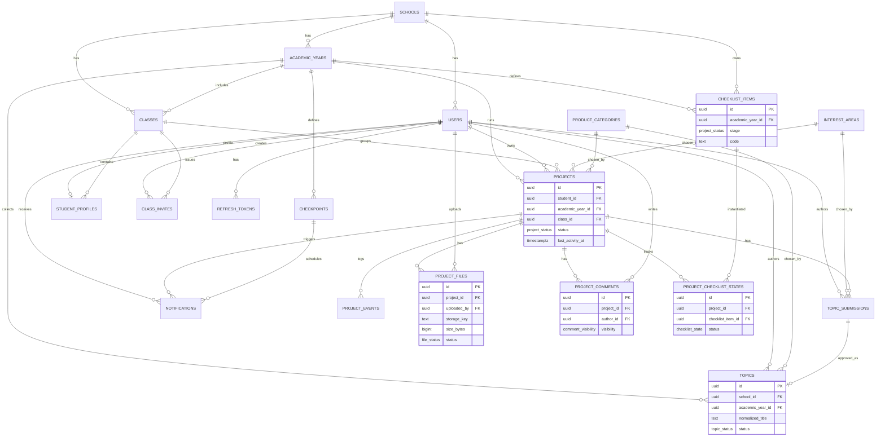
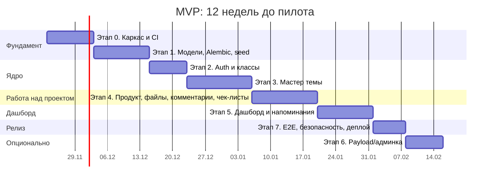

# План работ: «Индивидуальный проект» — MVP

> **Версия:** 1.3 · **Дата:** 2026-11-23
> **Что нового в 1.3:** добавлен этап 8 «Перенос на сервер»; prod-стек теперь настраивается только через `deploy/.env` (справочник — `docs/env.md`); образ backend собирается с extra `s3`; исправлены даты в UI и мелочи в compose/скриптах.
> **Что нового в 1.2:** этапы 0–7 реализованы; чек-листы актуализированы по фактическому состоянию; поведение MVP зафиксировано в OpenSpec (`core-mvp-baseline`). Внешние и отложенные пункты помечены явно.
> **Назначение:** единый рабочий документ по продукту, доменной модели и задачам.
> **Принцип:** сначала фиксируем границы и схему данных, потом пишем код. Всё, что не входит в четыре функции MVP, не делаем без отдельного решения.

## Кратко: ключевые решения

1. **Модели — SQLAlchemy 2.0 async.** `AsyncSession` + декларативные модели + Alembic-миграции; `asyncpg` как драйвер.
2. **Админка — вариант A (без Payload).** Тонкие CRUD-эндпоинты FastAPI + страницы Next.js под `/admin/**`; Payload CMS отклонён (см. ADR-05).
3. **Ядро MVP:** мастер темы с проверками на повтор и широту, помощник продукта, работа над проектом (файлы, комментарии, чек-листы), дашборд «кто застрял».
4. **Вне MVP:** чаты и видеозвонки, журнал, родители, оценки.
5. **Старт:** этап 0 (каркас и БД) → этап 1 (схема) → этап 2 (auth) → этап 3 (мастер темы) → этап 4 (продукт и работа над проектом) → этап 5 (дашборд) → этап 6 (админка, вариант A) → этап 7 (релиз) → этап 8 (перенос на сервер).

---

## 0. Как пользоваться документом

- **Разделы 1–5** — что строим и на каких данных. Их нужно прочитать до начала кодинга.
- **Раздел 6** — API-контракты.
- **Раздел 7** — задачи по этапам. Это основной чек-лист.
- **Раздел 8** — календарный план и критический путь.
- **Раздел 9–11** — риски, критерии приёмки, приложения с SQLAlchemy-паттернами и командами.

Обозначения:

| Метка | Значение |
|---|---|
| **P0** | Без этого MVP не существует |
| **P1** | Нужно для пилота, можно сделать после запуска ядра |
| **P2** | Отложено, не входит в MVP |
| **Оценка** | Идея-дни одного разработчика, включая тесты и документацию |

---

## 1. Продукт и границы

### 1.1. Ценность

Приложение помогает ученику 9–11 класса **начать индивидуальный проект вовремя** и **сформулировать тему**, а учителю — **увидеть, кто застрял, в сентябре, а не в апреле**.

Файлы и чек-листы — вспомогательные артефакты. Ключевая метрика — **скорость перехода от регистрации к утверждённой теме и определённому продукту**, а не количество загруженных файлов.

### 1.2. Четыре функции MVP

1. **Мастер формулировки темы**
   - сфера интересов → исследовательский вопрос → тема;
   - проверка на повтор по реестру прошлых тем;
   - проверка на «слишком широко»;
   - отправка темы учителю и решение учителя.
2. **Помощник в определении продукта**
   - выбор категории продукта (модель, макет, программа, исследование и т.д.);
   - описание продукта с подсказками и примерами;
   - фиксация результата в проекте.
3. **Дашборд учителя «кто застрял»**
   - цветовая индикация статуса по ученикам;
   - причины статуса, а не только цвет;
   - ранние контрольные точки и напоминания.
4. **Работа над проектом**
   - загрузка файлов работы и материалов;
   - комментарии учителя ученику;
   - чек-листы этапов с прогрессом.

### 1.3. Чего в продукте НЕТ

| Не делаем | Почему | Что делаем вместо |
|---|---|---|
| Чаты и видеозвонки | Отвлекает от ядра, сложно модерировать | Комментарии учителя без онлайн-переписки |
| Онлайн-просмотр и постраничное рецензирование файлов | Превращает продукт в LMS | Файл хранится как вложение, комментарии — к проекту |
| Интеграция с электронным журналом | Долгий цикл согласований, зависимость от вендоров | CSV-импорт учеников и ручное создание классов |
| Родительский кабинет | Не влияет на ключевую метрику MVP | — |
| Оценки и аттестация | Продукт не оценивает работу | Чек-листы и статусы без оценок |

### 1.4. Роли

| Роль | Что может |
|---|---|
| **Ученик** | Заполняет проект, проходит мастер темы, выбирает продукт, загружает файлы, отмечает чек-лист, читает комментарии учителя |
| **Учитель-куратор** | Видит свои классы, проверяет темы, подтверждает чек-лист, комментирует и видит дашборд «кто застрял» |
| **Администратор школы** | Управляет классами, учениками, справочниками, контрольными точками и шаблоном чек-листа |
| **Супер-админ платформы** | Управляет школами и глобальными справочниками, доступ к админке |

### 1.5. Метрики успеха MVP

| Метрика | Цель пилота |
|---|---|
| Доля учеников с утверждённой темой к 15 ноября | ≥ 70% |
| Медианное время от регистрации до первого черновика темы | ≤ 3 дня |
| Доля проектов с определённым продуктом к 15 декабря | ≥ 60% |
| Учитель открывает дашборд минимум раз в неделю | ≥ 80% учителей |
| Доля «красных» проектов снижается от сентября к февралю | устойчивое снижение |
| Доля тем, отклонённых из-за повтора | ≤ 10% после первой итерации мастера |
| Доля обязательных пунктов чек-листа, закрытых к контрольной точке | ≥ 70% |
| Доля проектов с загруженным итоговым файлом к 15 апреля | ≥ 80% |

---

## 2. Текущее состояние репозитория (снимок до этапа 0)

> ⚠️ Раздел сохранён как история планирования. Актуальное состояние: этапы 0–7
> реализованы, тесты и E2E зелёные, прод-стек описан в `deploy/` и `docs/env.md`.

| Область | Факт | Что делать |
|---|---|---|
| Backend | Только `app/main.py` с `GET /` → `{"message":"Hello World!"}` | Этап 0: каркас, конфиг, БД |
| Backend-зависимости | Есть `sqlalchemy`, `alembic`, `passlib`, `python-jose`; **нет** `asyncpg`, `redis`, `arq/celery`, S3-клиента | Оставить SQLAlchemy/Alembic, добавить `asyncpg`, Redis, storage SDK (см. ADR-01, ADR-09) |
| Python | `requires-python = ">=3.13"` | Оставляем 3.13, это совместимо с требованием 3.12+ |
| Файлы | Нет хранилища и таблиц | `media/` в dev, S3-совместимое хранилище в prod (ADR-09) |
| Комментарии и чек-листы | Нет моделей и API | Добавить в этапы 1 и 4 |
| Frontend | Стартовый `create-next-app`: Next 16.4.6, React 19.3, Tailwind 4.3.3 | Этап 0: shadcn/ui, API-клиент, русская локаль |
| Frontend-разметка | `lang="en"`, шрифт Geist с `subsets: ["latin"]`, дефолтные metadata | Исправить на `lang="ru"`, шрифт с кириллицей, русские metadata |
| Next.js 16 | В `next.config.ts` включены `cacheComponents`, `partialPrefetching`, `output: standalone` | Учитывать Cache Components и `proxy.ts` (см. ADR-04) |
| Postgres | `postgres:16-alpine` в dev/prod compose | Добавить Redis, healthchecks, Alembic-миграции |
| Redis | Отсутствует | Этап 5: напоминания и кэш |
| CI | Нет `.github/` | Этап 0: lint + tests + build |
| Документация | `deploy/README.md` есть, `backend/README.md` пустой, корневого README нет | Этап 0/7 |
| Безопасность prod | В `docker-compose.prod.yml` пароль по умолчанию `myschoolproject` | Убрать дефолт, требовать `POSTGRES_PASSWORD` |
| Docker prod backend | `uv run uvicorn` может подтянуть dev-группу зависимостей | Использовать `uv run --no-dev` или бинарь из `.venv` |
| Тесты | Нет | Этап 0–1: pytest + httpx + тестовая БД |

**Вывод:** репозиторий — хороший каркас, но доменного кода ещё нет. План начинается с этапа 0, а не с «дописать мастер темы».

---

## 3. Архитектурные решения (ADR)

### ADR-01. SQLAlchemy 2.0 async + Alembic

**Решение:** модель данных описывается декларативными моделями SQLAlchemy 2.0 (`DeclarativeBase`, `Mapped`, `mapped_column`). Доступ к БД — через `AsyncSession`; миграции — Alembic в async-режиме; драйвер — `asyncpg`.

**Как именно:**

1. Модели живут в `backend/app/models/*.py`, базовый класс — `app/db/base.py` (`DeclarativeBase` + naming convention для стабильных имён constraint'ов).
2. Все модели импортируются в `app/models/__init__.py`, а `alembic/env.py` импортирует этот пакет и передаёт `Base.metadata` в `target_metadata`.
3. Миграции создаются через `alembic revision --autogenerate -m "..."` и **обязательно ревьюятся вручную**. Автогенерация не является истиной: проверяем типы, индексы, `ondelete`, частичные индексы и enum'ы.
4. Сессия — `async_sessionmaker(engine, expire_on_commit=False)`, одна `AsyncSession` на HTTP-запрос через dependency.
5. Репозитории принимают `AsyncSession`, используют `select()`, `update()`, `delete()`, `insert()`. Сложные запросы — через `select()`/Core; точечный `text()` с bind-параметрами допустим, но не как основной стиль.
6. Связи загружаются явно: `selectinload`/`joinedload`, чтобы не ловить N+1 и `MissingGreenlet`.
7. Pydantic v2 — только для API-схем, не для ORM.

**Почему так:** быстрее писать, меньше ручного маппинга, типобезопасность, автогенерация миграций, удобные связи и каскады. SQLAlchemy уже есть в проекте, а команда явно выбрала этот путь.

**Цена:** нужно ревьюить автогенерацию, следить за N+1 и async-lazy-loading, не тащить бизнес-логику в модели. Миграции всё равно проверяются на чистой БД и в CI.

**Альтернатива (отклонена):** сырой SQL + собственный мигратор. Даёт полный контроль, но больше ручной работы и выше риск ошибок в маппинге.

> Все примеры в приложении A теперь показывают SQLAlchemy-эквиваленты, а не «сырой SQL как основной путь».

### ADR-02. `AsyncSession` + репозитории + сервисы

- `create_async_engine` и `async_sessionmaker` создаются в `lifespan`.
- Одна `AsyncSession` на запрос; закрывается dependency.
- Транзакция открывается в сервисе: `async with session.begin():`.
- Репозиторий принимает `AsyncSession`, не коммитит и не знает про HTTP.
- Сервис знает бизнес-правила: переходы статусов, проверки, права.
- Роутер валидирует вход, вызывает сервис и возвращает Pydantic-схему.
- Для сложных read-моделей (дашборд) допускается отдельный query-модуль с `select()` и явными joins.

### ADR-03. Аутентификация: JWT + httpOnly cookies + BFF-прокси

- Access token — 15 минут, refresh token — 30 дней.
- Оба токена передаются в `httpOnly`, `Secure` (в prod), `SameSite=Lax` cookies.
- Refresh-токены хранятся в БД в виде хеша, ротируются при обновлении.
- Повторное использование revoked refresh-токена → отзыв всей цепочки пользователя.
- Frontend ходит на `/api/...` своего origin; Next.js проксирует запросы на FastAPI через rewrites/route handler. Это убирает cross-origin проблемы с cookies.
- `proxy.ts` в Next 16 делает только оптимистичный редирект по наличию cookie. **Настоящая авторизация — на сервере** (FastAPI + проверка в server components/route handlers).

### ADR-04. Next.js 16: `proxy.ts`, Cache Components, русская локаль

В проекте уже включены `cacheComponents: true` и `partialPrefetching: true`. Это меняет привычные паттерны:

- `middleware.ts` в Next 16 переименован в `proxy.ts`; использовать только его.
- Чтение `cookies()`/сессии — это request-time операция. UI, зависящий от пользователя, оборачивается в `<Suspense>`; для кэшируемых функций используется `use cache: private` или `instant = false` на странице, если нужно временно оставить блокирующий рендер.
- Перед написанием кода читать локальную документацию: `frontend/node_modules/next/dist/docs/` (об этом прямо предупреждает `frontend/AGENTS.md`).
- Не использовать `dynamic`, `revalidate`, `fetchCache` как раньше — при Cache Components они заменены на `use cache`/`cacheLife`.

### ADR-05. Админка: Payload CMS — отдельный сервис, не в MVP

**Решение:** в MVP админка — тонкие CRUD-эндпоинты FastAPI + простые страницы Next.js для справочников. Payload CMS рассматривается на этапе 6 как **отдельное приложение** для контента и справочников, а не как админка над операционными таблицами.

**Почему:**

- Payload — headless CMS, а не универсальная админка над произвольной SQL-схемой. Он создаёт свои таблицы, миграции, preferences, locks и ожидает свои соглашения.
- Попытка «натравить» Payload на таблицы, которыми владеет FastAPI, даёт двух хозяев схемы, конфликты миграций и хрупкий маппинг.
- Для операционных данных (пользователи, проекты, темы) лучше явный API и обычные страницы.

**Допустимые варианты на этапе 6:**

| Вариант | Что делает Payload | Когда выбирать |
|---|---|---|
| **A. Без Payload** | Ничего; CRUD в FastAPI + Next | MVP, малая команда |
| **B. Отдельный `admin/` на Payload** | Справочники, школы, контрольные точки, шаблоны чек-листов, тексты помощи | Если редактирование контента стало узким местом |
| **C. Payload внутри `frontend/`** | Всё в одном Next-приложении | Не рекомендуется: связывает версии CMS и продукта, усложняет сборку и auth |

**Важно:** если `@payloadcms/next` не поддерживает Next 16 на момент этапа 6, отдельное админ-приложение можно собрать на поддерживаемой версии Next (например, 15), не понижая продуктовый frontend. Это ещё один аргумент за отдельный сервис.

### ADR-06. Фоновые задачи: Redis + ARQ (или Celery)

- Redis используется для очереди напоминаний и, при необходимости, кэша дашборда и rate limit.
- Для async-стека FastAPI рекомендуется **ARQ**: меньше конфигурации, нативный async.
- Celery допустим, если команда уже им владеет.
- Ежедневная задача считает, кому и какое напоминание создать, и делает это идемпотентно через `notifications.dedupe_key`.
- Email — опционально: сначала in-app, затем SMTP/провайдер.

### ADR-07. Один репозиторий, два образа, отдельные схемы БД

- `backend/` — FastAPI.
- `frontend/` — Next.js.
- `deploy/` — compose dev/prod.
- В одной БД Postgres 16 живут схема `public` (операционные данные, владелец — FastAPI) и, при включении Payload, схема `payload` (владелец — Payload). Смешивать владение нельзя.
- Роли БД:
  - `app_migrator` — владеет схемой `public`, применяет миграции;
  - `app_rw` — runtime-доступ FastAPI;
  - `app_ro` — чтение для отчётов/админки;
  - `payload` — отдельная роль для CMS.

### ADR-08. Персональные данные и 152-ФЗ

- Храним минимум: ФИО, email, класс, школа. Без даты рождения, СНИЛС, паспорта, адреса.
- Данные учеников — только для образовательного процесса; нужны согласие и политика обработки ПДн.
- Хостинг — в РФ (требование локализации), резервные копии — тоже.
- Срок хранения: учебный год + период, необходимый школе; удаление/анонимизация по регламенту.
- Доступ к данным — по ролям и school-scope; логирование действий администраторов.

### ADR-09. Файлы: абстракция хранилища и приватный доступ

**Решение:** файлы работ хранятся вне БД, метаданные — в `project_files`. В dev — локальный диск `backend/media/` (volume), в prod — S3-совместимое хранилище (Yandex Object Storage, Selectel, MinIO и т.п.).

- Интерфейс `StorageBackend` с методами `save`, `open`, `delete`, `presigned_url`.
- `LocalStorage` для dev; `S3Storage` для prod.
- Бакет приватный. Скачивание — только через авторизованный endpoint или короткоживущую подписанную ссылку.
- Лимиты: 25 МБ на файл, 10 файлов на проект (настраивается), allowlist MIME/расширений: PDF, DOCX, PPTX, PNG, JPEG, ZIP.
- Проверка размера, расширения и сигнатуры файла; sha256 для дедупликации.
- Антивирус — hook на статус `uploaded` → `available`/`quarantined`; ClamAV можно добавить позже.
- Имена файлов не используются как ключи: ключ = `projects/{project_id}/{uuid}{ext}`.
- Удаление — soft delete в БД + отложенное удаление из хранилища.

### ADR-10. Комментарии и чек-листы: без чата и без оценок

**Комментарии:**

- Пишет учитель (и school_admin), ученик читает. Ответов и тредов нет — это не чат.
- `visibility`: `student_visible` (видит ученик) и `teachers_only` (только педагоги).
- Комментарий привязан к проекту и, опционально, к этапу (`stage`).
- Новый комментарий создаёт уведомление ученику (если `student_visible`).

**Чек-листы:**

- `checklist_items` — шаблон этапов на учебный год/школу.
- `project_checklist_states` — состояние пункта у конкретного проекта.
- Статусы: `pending`, `in_progress`, `done`, `verified`, `skipped`.
- Ученик отмечает `in_progress`/`done`; учитель может подтвердить `verified`.
- Чек-лист — инструмент отслеживания, а не оценка. Баллы и аттестация не появляются.

---

## 4. Целевая структура проекта

```text
my-school-project/
├── backend/
│   ├── app/
│   │   ├── main.py
│   │   ├── api/
│   │   │   ├── deps.py
│   │   │   └── v1/
│   │   │       ├── router.py
│   │   │       ├── auth.py
│   │   │       ├── me.py
│   │   │       ├── reference.py
│   │   │       ├── projects.py
│   │   │       ├── topics.py
│   │   │       ├── products.py
│   │   │       ├── teacher.py
│   │   │       ├── notifications.py
│   │   │       ├── admin.py
│   │   │       └── health.py
│   │   ├── core/
│   │   │   ├── config.py
│   │   │   ├── security.py
│   │   │   ├── errors.py
│   │   │   ├── logging.py
│   │   │   └── rate_limit.py
│   │   ├── db/
│   │   │   ├── base.py
│   │   │   ├── session.py
│   │   │   └── seed.py
│   │   ├── models/
│   │   │   ├── __init__.py
│   │   │   ├── school.py
│   │   │   ├── user.py
│   │   │   ├── project.py
│   │   │   ├── topic.py
│   │   │   ├── file.py
│   │   │   ├── comment.py
│   │   │   ├── checklist.py
│   │   │   └── notification.py
│   │   ├── repositories/
│   │   │   ├── users.py
│   │   │   ├── classes.py
│   │   │   ├── projects.py
│   │   │   ├── topics.py
│   │   │   ├── dashboard.py
│   │   │   ├── files.py
│   │   │   ├── comments.py
│   │   │   ├── checklists.py
│   │   │   └── notifications.py
│   │   ├── services/
│   │   │   ├── auth.py
│   │   │   ├── topic_check.py
│   │   │   ├── product_guide.py
│   │   │   ├── status.py
│   │   │   ├── storage.py
│   │   │   ├── files.py
│   │   │   ├── comments.py
│   │   │   ├── checklists.py
│   │   │   └── reminders.py
│   │   ├── schemas/
│   │   │   ├── auth.py
│   │   │   ├── project.py
│   │   │   ├── topic.py
│   │   │   ├── product.py
│   │   │   ├── file.py
│   │   │   ├── comment.py
│   │   │   ├── checklist.py
│   │   │   └── dashboard.py
│   │   └── workers/
│   │       ├── settings.py
│   │       └── tasks.py
│   ├── alembic/
│   │   ├── env.py
│   │   └── versions/
│   ├── alembic.ini
│   ├── media/                # dev-хранилище файлов, в .gitignore
│   ├── tests/
│   ├── Dockerfile
│   └── pyproject.toml
├── frontend/
│   ├── app/
│   │   ├── (auth)/login/page.tsx
│   │   ├── (auth)/register/page.tsx
│   │   ├── (student)/cabinet/...
│   │   ├── (teacher)/teacher/...
│   │   ├── (admin)/admin/...
│   │   └── layout.tsx
│   ├── components/
│   │   ├── ui/                # shadcn/ui
│   │   └── ...
│   ├── lib/
│   │   ├── api.ts
│   │   ├── auth.ts
│   │   ├── env.ts
│   │   └── utils.ts
│   ├── types/
│   │   └── api.ts             # можно генерировать из OpenAPI
│   ├── proxy.ts               # Next 16
│   ├── next.config.ts
│   └── package.json
├── deploy/
│   ├── docker-compose.yml
│   ├── docker-compose.prod.yml
│   ├── .env.example
│   └── README.md
├── docs/
│   ├── adr/
│   ├── domain.md
│   └── runbook.md
├── .github/workflows/
├── TASKS.md
└── README.md
```

---

## 5. Доменная модель

### 5.1. ER-диаграмма



### 5.2. Перечисления (enum)

| Enum | Значения | Смысл |
|---|---|---|
| `user_role` | `student`, `teacher`, `school_admin`, `super_admin` | Роль пользователя |
| `project_status` | `idea`, `topic_draft`, `topic_submitted`, `topic_approved`, `product_draft`, `product_defined`, `in_progress`, `ready_for_defense`, `defended`, `archived` | Стадия проекта |
| `topic_submission_status` | `draft`, `submitted`, `approved`, `rejected`, `superseded` | Статус заявки на тему |
| `topic_status` | `active`, `archived` | Статус темы в реестре |
| `checkpoint_audience` | `student`, `teacher`, `both` | Для кого контрольная точка |
| `notification_type` | `topic_decision`, `topic_review`, `checkpoint_due`, `inactivity`, `teacher_digest`, `new_comment`, `checklist_due` | Тип уведомления |
| `notification_channel` | `in_app`, `email` | Канал |
| `notification_status` | `pending`, `sent`, `failed` | Статус отправки |
| `file_kind` | `research_draft`, `final_work`, `presentation`, `product_media`, `other` | Назначение файла |
| `file_status` | `uploaded`, `available`, `quarantined`, `deleted` | Состояние файла |
| `comment_visibility` | `student_visible`, `teachers_only` | Кому виден комментарий |
| `checklist_state` | `pending`, `in_progress`, `done`, `verified`, `skipped` | Состояние пункта чек-листа |

**Порядок статусов проекта** задаётся маппингом `PROJECT_STATUS_RANK` в `app/models/enums.py` (или `case()` в запросах), а не порядком enum в Postgres. Это защищает от неожиданностей при добавлении значений.

### 5.3. Сущности

#### Группа A. Организация и идентичность

**`schools`** — школа.

| Поле | Тип | Правила |
|---|---|---|
| `id` | `uuid` | PK, `gen_random_uuid()` |
| `name` | `text` | NOT NULL |
| `region` | `text` | NULL |
| `city` | `text` | NULL |
| `timezone` | `text` | NOT NULL, по умолчанию `Europe/Moscow` |
| `is_active` | `boolean` | NOT NULL, по умолчанию `true` |
| `created_at`, `updated_at` | `timestamptz` | NOT NULL, `now()` |

**`academic_years`** — учебный год школы.

| Поле | Тип | Правила |
|---|---|---|
| `id` | `uuid` | PK |
| `school_id` | `uuid` | FK → `schools`, `ON DELETE CASCADE` |
| `name` | `text` | Например, `2026/2027` |
| `starts_on`, `ends_on` | `date` | NOT NULL |
| `is_current` | `boolean` | NOT NULL, по умолчанию `false` |
| `created_at` | `timestamptz` | NOT NULL |

Ограничения: `UNIQUE (school_id, name)`; частичный уникальный индекс «один текущий год на школу»: `UNIQUE (school_id) WHERE is_current`.

**`classes`** — класс (учебная группа).

| Поле | Тип | Правила |
|---|---|---|
| `id` | `uuid` | PK |
| `school_id` | `uuid` | FK → `schools` |
| `academic_year_id` | `uuid` | FK → `academic_years` |
| `grade` | `smallint` | CHECK 9..11 |
| `label` | `text` | Например, `9А` |
| `curator_id` | `uuid` | FK → `users`, NULL, ON DELETE SET NULL |
| `created_at`, `updated_at` | `timestamptz` | NOT NULL |

Ограничения: `UNIQUE (school_id, academic_year_id, grade, label)`; индекс по `curator_id`.

**`users`** — учётная запись.

| Поле | Тип | Правила |
|---|---|---|
| `id` | `uuid` | PK |
| `school_id` | `uuid` | FK → `schools`, NULL только для `super_admin` |
| `role` | `user_role` | NOT NULL |
| `email` | `citext` | NOT NULL, UNIQUE |
| `password_hash` | `text` | NOT NULL |
| `full_name` | `text` | NOT NULL |
| `is_active` | `boolean` | NOT NULL, по умолчанию `true` |
| `must_change_password` | `boolean` | NOT NULL, по умолчанию `false` |
| `last_login_at` | `timestamptz` | NULL |
| `created_at`, `updated_at` | `timestamptz` | NOT NULL |
| `deleted_at` | `timestamptz` | NULL, мягкое удаление |

Индексы: `(school_id, role)`, `(role)`.

**`student_profiles`** — профиль ученика.

| Поле | Тип | Правила |
|---|---|---|
| `user_id` | `uuid` | PK, FK → `users`, `ON DELETE CASCADE` |
| `class_id` | `uuid` | FK → `classes`, NOT NULL |
| `created_at` | `timestamptz` | NOT NULL |

Индекс по `class_id`. У одного ученика — один профиль.

**`class_invites`** — код приглашения в класс.

| Поле | Тип | Правила |
|---|---|---|
| `id` | `uuid` | PK |
| `class_id` | `uuid` | FK → `classes`, `ON DELETE CASCADE` |
| `code` | `text` | UNIQUE, короткий код |
| `created_by` | `uuid` | FK → `users` |
| `expires_at` | `timestamptz` | NOT NULL |
| `max_uses` | `integer` | NULL = без ограничения |
| `uses_count` | `integer` | NOT NULL, по умолчанию 0 |
| `revoked_at` | `timestamptz` | NULL |
| `created_at` | `timestamptz` | NOT NULL |

CHECK: `uses_count >= 0 AND (max_uses IS NULL OR uses_count <= max_uses)`.

**`refresh_tokens`** — refresh-токены.

| Поле | Тип | Правила |
|---|---|---|
| `id` | `uuid` | PK |
| `user_id` | `uuid` | FK → `users`, `ON DELETE CASCADE` |
| `token_hash` | `text` | UNIQUE, NOT NULL |
| `expires_at` | `timestamptz` | NOT NULL |
| `revoked_at` | `timestamptz` | NULL |
| `user_agent` | `text` | NULL |
| `ip` | `inet` | NULL |
| `created_at` | `timestamptz` | NOT NULL |

Индексы: `(user_id)`, `(expires_at)`.

#### Группа B. Справочники

**`interest_areas`** — сферы интересов.

| Поле | Тип | Правила |
|---|---|---|
| `id` | `uuid` | PK |
| `slug` | `citext` | UNIQUE, NOT NULL |
| `name` | `text` | NOT NULL |
| `description` | `text` | NULL |
| `is_active` | `boolean` | NOT NULL, по умолчанию `true` |
| `sort_order` | `integer` | NOT NULL, по умолчанию 100 |
| `created_at`, `updated_at` | `timestamptz` | NOT NULL |

**`product_categories`** — категории продукта.

| Поле | Тип | Правила |
|---|---|---|
| `id` | `uuid` | PK |
| `slug` | `citext` | UNIQUE, NOT NULL |
| `name` | `text` | NOT NULL |
| `description` | `text` | NULL |
| `guidance` | `jsonb` | Примеры, требования, частые ошибки, подсказка к защите |
| `is_active` | `boolean` | NOT NULL, по умолчанию `true` |
| `sort_order` | `integer` | NOT NULL, по умолчанию 100 |
| `created_at`, `updated_at` | `timestamptz` | NOT NULL |

Пример `guidance`:

```json
{
  "examples": ["Действующая модель очистки воды", "Макет школьного двора"],
  "must_have": ["Понятная функция", "Материалы или технологии", "Что покажешь на защите"],
  "common_mistakes": ["Продукт не связан с вопросом", "Нет результата, который можно показать"],
  "defense_tip": "Покажи продукт и объясни, как он отвечает на исследовательский вопрос."
}
```

#### Группа C. Ядро процесса

**`projects`** — проект ученика на учебный год.

| Поле | Тип | Правила |
|---|---|---|
| `id` | `uuid` | PK |
| `student_id` | `uuid` | FK → `users`, NOT NULL |
| `academic_year_id` | `uuid` | FK → `academic_years`, NOT NULL |
| `class_id` | `uuid` | FK → `classes`, NOT NULL (снимок класса на момент создания) |
| `status` | `project_status` | NOT NULL, по умолчанию `idea` |
| `interest_area_id` | `uuid` | FK → `interest_areas`, NULL |
| `research_question` | `text` | NULL |
| `product_category_id` | `uuid` | FK → `product_categories`, NULL |
| `product_description` | `text` | NULL |
| `product_brief` | `jsonb` | NULL, расширяемые поля без миграции |
| `last_activity_at` | `timestamptz` | NOT NULL, по умолчанию `now()` |
| `topic_approved_at` | `timestamptz` | NULL |
| `product_defined_at` | `timestamptz` | NULL |
| `created_at`, `updated_at` | `timestamptz` | NOT NULL |
| `archived_at` | `timestamptz` | NULL |

Ограничения и индексы:

- `UNIQUE (student_id, academic_year_id)` — один проект на ученика в год;
- `(academic_year_id, class_id, status) WHERE archived_at IS NULL`;
- `(last_activity_at)`;
- `(student_id)`.

**`topic_submissions`** — история заявок на тему.

| Поле | Тип | Правила |
|---|---|---|
| `id` | `uuid` | PK |
| `project_id` | `uuid` | FK → `projects`, `ON DELETE CASCADE` |
| `school_id` | `uuid` | Денормализация для проверок и реестра |
| `academic_year_id` | `uuid` | Денормализация |
| `author_student_id` | `uuid` | Денормализация |
| `interest_area_id` | `uuid` | FK → `interest_areas`, NULL |
| `research_question` | `text` | NOT NULL |
| `title` | `text` | NOT NULL |
| `normalized_title` | `text` | NOT NULL |
| `status` | `topic_submission_status` | NOT NULL, по умолчанию `draft` |
| `duplicate_score` | `numeric(4,3)` | NULL, 0..1 |
| `duplicate_of_topic_id` | `uuid` | NULL, FK → `topics` (добавляется после создания `topics`) |
| `broadness_score` | `smallint` | NULL, 0..100 |
| `broadness_reasons` | `jsonb` | NULL, массив причин и подсказок |
| `review_comment` | `text` | NULL |
| `reviewed_by` | `uuid` | FK → `users`, NULL |
| `reviewed_at` | `timestamptz` | NULL |
| `created_at`, `updated_at` | `timestamptz` | NOT NULL |

Ограничения и индексы:

- частичный уникальный индекс: `UNIQUE (project_id) WHERE status IN ('draft', 'submitted')` — не больше одной активной заявки;
- `(project_id, created_at DESC)`;
- `(school_id, academic_year_id, status)`;
- GIN-индекс по `normalized_title` с `gin_trgm_ops`.

**`topics`** — реестр утверждённых/прошлых тем.

| Поле | Тип | Правила |
|---|---|---|
| `id` | `uuid` | PK |
| `school_id` | `uuid` | FK → `schools`, NOT NULL |
| `academic_year_id` | `uuid` | FK → `academic_years`, NOT NULL |
| `title` | `text` | NOT NULL |
| `normalized_title` | `text` | NOT NULL |
| `research_question` | `text` | NULL |
| `product_category_id` | `uuid` | FK → `product_categories`, NULL |
| `author_student_id` | `uuid` | FK → `users`, NULL |
| `source_submission_id` | `uuid` | UNIQUE, FK → `topic_submissions`, NULL |
| `status` | `topic_status` | NOT NULL, по умолчанию `active` |
| `approved_at` | `timestamptz` | NOT NULL |
| `created_at` | `timestamptz` | NOT NULL |

Ограничения:

- `UNIQUE (school_id, normalized_title)` — точный повтор темы в школе запрещён (включая прошлые годы);
- GIN-индекс по `normalized_title`;
- индекс `(school_id, academic_year_id, status)`.

#### Группа D. Вовлечённость

**`checkpoints`** — контрольные точки.

| Поле | Тип | Правила |
|---|---|---|
| `id` | `uuid` | PK |
| `school_id` | `uuid` | NULL = глобальная точка платформы |
| `academic_year_id` | `uuid` | FK → `academic_years` |
| `code` | `text` | Например, `topic_approved` |
| `title` | `text` | NOT NULL |
| `description` | `text` | NULL |
| `due_at` | `timestamptz` | NOT NULL |
| `required_status` | `project_status` | Статус, который должен быть достигнут к дате |
| `audience` | `checkpoint_audience` | По умолчанию `student` |
| `is_active` | `boolean` | NOT NULL, по умолчанию `true` |
| `sort_order` | `integer` | NOT NULL, по умолчанию 100 |
| `created_at`, `updated_at` | `timestamptz` | NOT NULL |

Ограничение: `UNIQUE NULLS NOT DISTINCT (school_id, academic_year_id, code)` (Postgres 16 поддерживает `NULLS NOT DISTINCT`).

**Контрольные точки — это даты и напоминания.** Факт выполнения этапов хранится отдельно, в чек-листе (`project_checklist_states`), а не в контрольной точке. Просрочка контрольной точки вычисляется сравнением `required_status` и текущего статуса проекта.

**`notifications`** — уведомления.

| Поле | Тип | Правила |
|---|---|---|
| `id` | `uuid` | PK |
| `user_id` | `uuid` | FK → `users`, `ON DELETE CASCADE` |
| `project_id` | `uuid` | FK → `projects`, NULL |
| `checkpoint_id` | `uuid` | FK → `checkpoints`, NULL |
| `type` | `notification_type` | NOT NULL |
| `channel` | `notification_channel` | NOT NULL |
| `status` | `notification_status` | NOT NULL, по умолчанию `pending` |
| `title` | `text` | NOT NULL |
| `body` | `text` | NOT NULL |
| `payload` | `jsonb` | NULL |
| `dedupe_key` | `text` | UNIQUE, NOT NULL |
| `scheduled_at` | `timestamptz` | NOT NULL |
| `sent_at` | `timestamptz` | NULL |
| `read_at` | `timestamptz` | NULL |
| `created_at` | `timestamptz` | NOT NULL |

Индексы: `(user_id, read_at)`, `(status, scheduled_at)`.

**`project_events`** — журнал значимых действий.

| Поле | Тип | Правила |
|---|---|---|
| `id` | `bigserial` | PK |
| `project_id` | `uuid` | FK → `projects`, `ON DELETE CASCADE` |
| `actor_id` | `uuid` | FK → `users`, NULL |
| `event_type` | `text` | Например, `topic_submitted`, `topic_approved`, `file_uploaded`, `comment_added`, `checklist_updated` |
| `payload` | `jsonb` | NULL |
| `created_at` | `timestamptz` | NOT NULL, `now()` |

Индексы: `(project_id, created_at DESC)`, `(event_type, created_at DESC)`.

#### Группа E. Работа над проектом

**`project_files`** — файлы работы и материалов.

| Поле | Тип | Правила |
|---|---|---|
| `id` | `uuid` | PK |
| `project_id` | `uuid` | FK → `projects`, `ON DELETE CASCADE` |
| `uploaded_by` | `uuid` | FK → `users`, `ON DELETE SET NULL` |
| `kind` | `file_kind` | NOT NULL, по умолчанию `final_work` |
| `original_name` | `text` | NOT NULL, только для отображения |
| `storage_key` | `text` | UNIQUE, NOT NULL, ключ в хранилище |
| `mime_type` | `text` | NOT NULL |
| `size_bytes` | `bigint` | NOT NULL, CHECK `> 0 AND <= 26214400` (25 МБ) |
| `checksum_sha256` | `text` | NOT NULL |
| `status` | `file_status` | NOT NULL, по умолчанию `uploaded` |
| `scanned_at` | `timestamptz` | NULL |
| `deleted_at` | `timestamptz` | NULL, soft delete |
| `created_at` | `timestamptz` | NOT NULL |

Ограничения и индексы:

- `UNIQUE (project_id, checksum_sha256)` — защита от повторной загрузки того же файла;
- `(project_id, created_at DESC)`;
- `(status)` — для очереди сканирования и очистки.

**`project_comments`** — комментарии учителя к проекту.

| Поле | Тип | Правила |
|---|---|---|
| `id` | `uuid` | PK |
| `project_id` | `uuid` | FK → `projects`, `ON DELETE CASCADE` |
| `author_id` | `uuid` | FK → `users`, `ON DELETE SET NULL` |
| `body` | `text` | NOT NULL, CHECK `char_length(body) BETWEEN 1 AND 5000` |
| `visibility` | `comment_visibility` | NOT NULL, по умолчанию `student_visible` |
| `stage` | `project_status` | NULL, к какому этапу относится |
| `created_at`, `updated_at` | `timestamptz` | NOT NULL |
| `deleted_at` | `timestamptz` | NULL, soft delete |

Индексы: `(project_id, created_at DESC)`, `(author_id)`.

**`checklist_items`** — шаблон пунктов чек-листа.

| Поле | Тип | Правила |
|---|---|---|
| `id` | `uuid` | PK |
| `school_id` | `uuid` | NULL = глобальный шаблон платформы |
| `academic_year_id` | `uuid` | FK → `academic_years` |
| `stage` | `project_status` | NOT NULL, к какому этапу относится |
| `code` | `text` | NOT NULL, например `collect_sources` |
| `title` | `text` | NOT NULL |
| `description` | `text` | NULL |
| `sort_order` | `integer` | NOT NULL, по умолчанию 100 |
| `is_required` | `boolean` | NOT NULL, по умолчанию `true` |
| `due_at` | `timestamptz` | NULL, для просрочки пункта |
| `is_active` | `boolean` | NOT NULL, по умолчанию `true` |
| `created_at`, `updated_at` | `timestamptz` | NOT NULL |

Ограничения и индексы:

- `UNIQUE NULLS NOT DISTINCT (school_id, academic_year_id, code)`;
- `(academic_year_id, stage, sort_order) WHERE is_active`.

**`project_checklist_states`** — состояние пункта у конкретного проекта.

| Поле | Тип | Правила |
|---|---|---|
| `id` | `uuid` | PK |
| `project_id` | `uuid` | FK → `projects`, `ON DELETE CASCADE` |
| `checklist_item_id` | `uuid` | FK → `checklist_items`, `ON DELETE CASCADE` |
| `status` | `checklist_state` | NOT NULL, по умолчанию `pending` |
| `comment` | `text` | NULL, комментарий ученика к пункту |
| `marked_by` | `uuid` | FK → `users`, NULL |
| `marked_at` | `timestamptz` | NULL |
| `verified_by` | `uuid` | FK → `users`, NULL |
| `verified_at` | `timestamptz` | NULL |
| `updated_at` | `timestamptz` | NOT NULL |

Ограничения и индексы:

- `UNIQUE (project_id, checklist_item_id)` — одно состояние на пункт;
- `(project_id, status)`;
- `(checklist_item_id)`.

### 5.4. Правила целостности

1. **Один проект на ученика в учебном году.** `UNIQUE (student_id, academic_year_id)`.
2. **Одна активная заявка на тему.** `UNIQUE (project_id) WHERE status IN ('draft','submitted')`.
3. **Точный повтор темы в школе запрещён.** `UNIQUE (school_id, normalized_title)` в `topics`.
4. **Учитель не проверяет собственную тему.** Проверка в сервисе: `reviewer.id != project.student_id` (и вообще учитель не может быть учеником).
5. **Школьная изоляция.** Все запросы учителя/админа фильтруются по `school_id`; ученик видит только свой проект.
6. **Согласованность класса и школы.** При создании проекта `class_id` должен принадлежать той же школе, что и ученик. Проверяется в сервисе и покрывается тестом; при необходимости добавляется составной FK.
7. **Переходы статусов только вперёд по бизнес-смыслу.** Реализуются сервисом через `update(Model).where(Model.id == id, Model.status == expected)` и проверку `rowcount`; если 0 — конфликт 409.
8. **`last_activity_at` — это активность ученика:** сохранение черновика, отправка темы, загрузка файла, отметка пункта чек-листа, сохранение продукта. Комментарии и проверки учителя пишутся в события, но не обновляют активность ученика. Просмотры страниц и логины не считаются работой.
9. **Файлы принадлежат проекту.** Загружает ученик-владелец; учитель и school_admin могут скачивать в рамках своего класса/школы. Файл не становится публичным.
10. **Один state на пункт чек-листа.** `UNIQUE (project_id, checklist_item_id)`. Состояния создаются при создании проекта или лениво при первом чтении.
11. **Комментарии — не чат.** Учитель пишет, ученик читает; `teachers_only` не отдаётся ученику. Ответов и тредов в MVP нет.
12. **Чек-лист не является оценкой.** `verified` подтверждает выполнение пункта, но не выставляет балл и не заменяет аттестацию.

### 5.5. Статусы, «застрял» и контрольные точки

**Шкала статусов:**

| Статус | Ранг | Что означает |
|---|---:|---|
| `idea` | 10 | Проект создан, темы нет |
| `topic_draft` | 20 | Есть черновик темы |
| `topic_submitted` | 30 | Тема на проверке |
| `topic_approved` | 40 | Тема утверждена |
| `product_draft` | 50 | Выбирает продукт |
| `product_defined` | 60 | Продукт определён |
| `in_progress` | 70 | Идёт работа |
| `ready_for_defense` | 80 | Готов к защите |
| `defended` | 90 | Защищён |
| `archived` | — | Исключён из активных |

**Правила цвета** (вычисляются, не хранятся):

| Цвет | Условия (любое из) |
|---|---|
| 🔴 `red` | просрочена контрольная точка; просрочен обязательный пункт чек-листа; нет активности > 14 дней; тема не утверждена и прошла ранняя контрольная точка |
| 🟡 `yellow` | нет активности 7–14 дней; до ближайшей контрольной точки ≤ 7 дней и требуемый статус не достигнут; тема висит на проверке > 5 дней; обязательный пункт чек-листа не закрыт и до дедлайна ≤ 3 дней |
| 🟢 `green` | остальные случаи |

**Коды причин** для API и UI:

- `NO_ACTIVITY_14D`, `NO_ACTIVITY_7D`
- `CHECKPOINT_OVERDUE`, `CHECKPOINT_SOON`
- `CHECKLIST_OVERDUE`, `CHECKLIST_STALLED`
- `TOPIC_NOT_APPROVED`
- `AWAITING_REVIEW`
- `NO_PROJECT`
- `PRODUCT_NOT_DEFINED`
- `NO_FINAL_FILE`

Учитель видит не только цвет, но и текст причины, прогресс чек-листа и последний комментарий. Цвет без причины — плохой UX и риск недоверия к дашборду.

**Ранние контрольные точки по умолчанию:**

| Код | Дата (пример) | Требуемый статус |
|---|---|---|
| `topic_draft` | 15.10 | `topic_draft` |
| `topic_approved` | 15.11 | `topic_approved` |
| `product_defined` | 15.12 | `product_defined` |
| `midway_check` | 01.03 | `in_progress` |
| `ready_for_defense` | 15.04 | `ready_for_defense` |

Даты — настройка школы, а не константа в коде.

**Базовый чек-лист по умолчанию (пример):**

| Этап | Пункт |
|---|---|
| `topic_draft` | Выбрать сферу интересов |
| `topic_draft` | Сформулировать исследовательский вопрос |
| `topic_draft` | Подготовить черновик темы |
| `topic_submitted` | Отправить тему учителю |
| `topic_approved` | Утвердить тему |
| `product_draft` | Выбрать категорию продукта |
| `product_defined` | Описать продукт и результат |
| `in_progress` | Собрать источники |
| `in_progress` | Провести исследование/изготовление |
| `in_progress` | Загрузить итоговый файл |
| `ready_for_defense` | Подготовить презентацию |
| `ready_for_defense` | Отрепетировать защиту |

### 5.6. Что сознательно не моделируем

- онлайн-чаты и ответы ученика на комментарии (комментарии односторонние);
- онлайн-просмотр и постраничное рецензирование файлов;
- оценки, журнал, расписание;
- родителей;
- интеграции с внешними системами;
- embeddings и ML-проверку тем (можно добавить позже, но не в MVP);
- сложную иерархию справочников (подкатегории интересов) — при необходимости добавим `parent_id`.

---

## 6. API: соглашения и контракты

### 6.1. Общие правила

- Префикс: `/api/v1`.
- Формат ошибок — близкий к RFC 7807 + машинный `code`:

```json
{
  "type": "about:blank",
  "title": "topic_too_broad",
  "status": 422,
  "detail": "Тема слишком широкая: не хватает объекта, места или периода.",
  "code": "TOPIC_TOO_BROAD",
  "errors": [
    {"field": "title", "message": "Добавьте конкретный объект исследования"}
  ]
}
```

- Пагинация: `limit`, `offset` для списков; для больших — keyset позже.
- Все даты — ISO 8601 с таймзоной.
- Все ID — UUID.
- Идемпотентность: повторная отправка темы с тем же `Idempotency-Key` не создаёт дубль (P1).
- OpenAPI — источник истины; типы для фронтенда можно генерировать через `openapi-typescript`.

### 6.2. Основные эндпоинты

| Метод | Путь | Роль | Назначение |
|---|---|---|---|
| POST | `/auth/register/student` | публично + invite | Регистрация по коду класса |
| POST | `/auth/login` | публично | Вход |
| POST | `/auth/refresh` | cookie | Ротация refresh |
| POST | `/auth/logout` | auth | Выход |
| GET | `/auth/me` | auth | Текущий пользователь |
| POST | `/auth/change-password` | auth | Смена пароля |
| GET | `/reference/interest-areas` | auth | Сферы интересов |
| GET | `/reference/product-categories` | auth | Категории продукта |
| GET | `/me/project` | student | Мой проект на текущий год |
| PATCH | `/me/project` | student | Сфера интересов, черновик |
| POST | `/me/project/topic/check` | student | Проверка темы без сохранения |
| POST | `/me/project/topic/submit` | student | Отправить тему |
| PATCH | `/me/project/product` | student | Категория и описание продукта |
| POST | `/me/project/files` | student | Загрузить файл (multipart) |
| GET | `/me/project/files` | student | Список файлов |
| GET | `/files/{id}/download` | auth | Скачать файл по правам |
| DELETE | `/me/project/files/{id}` | student | Удалить файл (soft delete) |
| GET | `/me/project/checklist` | student | Чек-лист с прогрессом |
| PATCH | `/me/project/checklist/{item_id}` | student | Отметить пункт чек-листа |
| GET | `/me/project/comments` | student | Комментарии учителя |
| GET | `/me/notifications` | auth | Мои уведомления |
| POST | `/me/notifications/{id}/read` | auth | Отметить прочитанным |
| GET | `/teacher/classes` | teacher | Мои классы |
| GET | `/teacher/projects/{id}` | teacher | Карточка проекта |
| GET | `/teacher/projects/{id}/files` | teacher | Файлы проекта |
| GET | `/teacher/projects/{id}/checklist` | teacher | Чек-лист проекта |
| POST | `/teacher/projects/{id}/comments` | teacher | Оставить комментарий |
| PATCH/DELETE | `/teacher/comments/{id}` | teacher | Изменить/удалить комментарий |
| POST | `/teacher/checklist-states/{id}/verify` | teacher | Подтвердить пункт чек-листа |
| GET | `/teacher/classes/{id}/dashboard` | teacher | Дашборд «кто застрял» |
| GET | `/teacher/submissions` | teacher | Очередь тем на проверку |
| POST | `/teacher/submissions/{id}/approve` | teacher | Утвердить тему |
| POST | `/teacher/submissions/{id}/reject` | teacher | Отклонить с комментарием |
| GET | `/teacher/topics` | teacher | Реестр тем |
| GET | `/admin/schools` | school_admin/super | Школы |
| GET/POST/PATCH | `/admin/classes` | school_admin | Классы |
| POST | `/admin/classes/{id}/invites` | teacher/admin | Создать код приглашения |
| GET/POST/PATCH | `/admin/checkpoints` | school_admin | Контрольные точки |
| GET/POST/PATCH | `/admin/checklist-items` | school_admin | Шаблон чек-листа |
| GET/POST/PATCH | `/admin/reference/interest-areas` | super_admin | Справочник интересов |
| GET/POST/PATCH | `/admin/reference/product-categories` | super_admin | Справочник продуктов |
| POST | `/admin/import/students` | school_admin | CSV-импорт (P1) |
| GET | `/healthz` | публично | Liveness |
| GET | `/readyz` | публично | Готовность БД и Redis |

---

## 7. Задачи по этапам

### Этап 0. Фундамент (P0)

**Результат этапа:** приложение запускается, конфигурируется, подключается к Postgres, миграции работают, CI зелёный, frontend-каркас готов.

| ID | Задача | Оценка | Зависит от |
|---|---|---:|---|
| T0.1 | ADR и границы MVP | 0.5 | — |
| T0.2 | Конфигурация и секреты | 0.5 | T0.1 |
| T0.3 | SQLAlchemy, Alembic и подключение к БД | 1.5 | T0.2 |
| T0.4 | Каркас FastAPI | 1 | T0.2 |
| T0.5 | Docker, Redis, healthchecks | 1 | T0.3 |
| T0.6 | CI и качество кода | 1 | T0.3, T0.4 |
| T0.7 | Frontend-фундамент | 1.5 | T0.2 |

#### T0.1. Зафиксировать ADR и границы MVP

**Приоритет:** P0 · **Оценка:** 0.5 дня · **Зависит от:** —

**Результат:** команда одинаково понимает, что делаем и чего не делаем.

**Шаги:**

1. Создать `docs/adr/` и перенести решения ADR-01…ADR-08 из этого документа.
2. Зафиксировать роли и четыре функции MVP.
3. Зафиксировать список «не делаем» и правило: новая функция добавляется только через изменение ADR.
4. Определить пилотную школу, классы, учителей и ответственного за контент.
5. Согласовать учебный год и даты контрольных точек.

**Готово, когда:**

- [x] ADR лежат в репозитории и ссылаются друг на друга.
- [x] Есть один документ `docs/domain.md` с ER-моделью и статусами.
- [ ] Пилотные участники и даты известны. ← организационный шаг вне репозитория.

**Файлы:** `docs/adr/*.md`, `docs/domain.md`, `TASKS.md`.

#### T0.2. Конфигурация и секреты

**Приоритет:** P0 · **Оценка:** 0.5 дня · **Зависит от:** T0.1

**Результат:** приложение падает при старте, если не хватает критичных переменных.

**Шаги:**

1. Добавить `pydantic-settings`-конфиг в `app/core/config.py`.
2. Описать переменные:
   - `ENV` (`dev`/`prod`);
   - `DATABASE_URL`;
   - `JWT_SECRET`, `ACCESS_TOKEN_TTL_MIN`, `REFRESH_TOKEN_TTL_DAYS`;
   - `CORS_ORIGINS`;
   - `REDIS_URL`;
   - `BACKEND_URL` для Next rewrites;
   - `TOPIC_DUPLICATE_WARN`, `TOPIC_DUPLICATE_BLOCK`;
   - `TOPIC_BROADNESS_*`;
   - пороги дашборда: `INACTIVITY_YELLOW_DAYS`, `INACTIVITY_RED_DAYS`, `CHECKPOINT_SOON_DAYS`, `CHECKLIST_SOON_DAYS`, `CHECKLIST_STALLED_DAYS`, `FINAL_FILE_DAYS_BEFORE`, `REVIEW_WAIT_DAYS`;
   - `STORAGE_BACKEND` (`local`/`s3`), `MEDIA_ROOT`, `MAX_UPLOAD_BYTES`, `ALLOWED_UPLOAD_MIME`;
   - `S3_ENDPOINT`, `S3_BUCKET`, `S3_ACCESS_KEY`, `S3_SECRET_KEY`, `S3_REGION`;
   - `EMAIL_*` (опционально).
3. Создать `backend/.env.example` без секретов; `.env` оставить локальным и в `.gitignore`.
4. Добавить валидацию: в `prod` запрещены дефолтные секреты и пустой `JWT_SECRET`.
5. Добавить тест на загрузку настроек.

**Готово, когда:**

- [x] Приложение не стартует без `DATABASE_URL` и `JWT_SECRET`.
- [x] `.env.example` содержит все переменные с комментариями.
- [x] Секреты не попадают в git.

**Файлы:** `backend/app/core/config.py`, `backend/.env.example`, `backend/pyproject.toml`, `backend/tests/test_config.py`.

#### T0.3. SQLAlchemy, Alembic и подключение к БД

**Приоритет:** P0 · **Оценка:** 1.5 дня · **Зависит от:** T0.2

**Результат:** приложение подключается к Postgres через `AsyncSession`, миграции применяются Alembic.

**Шаги:**

1. Оставить `sqlalchemy[asyncio]` и `alembic`; добавить `asyncpg` (драйвер).
2. Создать `app/db/base.py`:
   - `class Base(DeclarativeBase)`;
   - `metadata = MetaData(naming_convention={...})` для стабильных имён constraint'ов;
   - общий миксин `TimestampMixin` с `created_at`/`updated_at`.
3. Создать `app/db/session.py`:
   - `create_async_engine(settings.DATABASE_URL, pool_pre_ping=True)`;
   - `async_sessionmaker(engine, expire_on_commit=False)`;
   - dependency `get_session()` с закрытием сессии.
4. Инициализировать Alembic async-шаблоном: `alembic init -t async alembic`.
5. В `alembic/env.py` импортировать `app.models` и передать `Base.metadata` в `target_metadata`.
6. Создать первую ревизию `0001_extensions` с `op.execute("CREATE EXTENSION IF NOT EXISTS citext")` и `pg_trgm`.
7. Добавить `/readyz`, который делает `SELECT 1` через `AsyncSession`.
8. Написать тест: `alembic upgrade head` на пустой БД, затем `downgrade base`.

**Готово, когда:**

- [x] `uv run alembic upgrade head` работает на чистой БД.
- [x] `uv run alembic downgrade base` откатывает.
- [x] `/readyz` возвращает 200 при живой БД.
- [x] Модели и `target_metadata` импортируются без циклических зависимостей.

**Файлы:** `backend/app/db/base.py`, `backend/app/db/session.py`, `backend/alembic.ini`, `backend/alembic/env.py`, `backend/alembic/versions/0001_extensions.py`, `backend/tests/test_migrations.py`.

#### T0.4. Каркас FastAPI

**Приоритет:** P0 · **Оценка:** 1 день · **Зависит от:** T0.2

**Результат:** чистая структура API, единый формат ошибок, логирование, healthcheck.

**Шаги:**

1. Переписать `app/main.py`: `create_app()`, `lifespan` для пула БД.
2. Добавить `app/api/v1/router.py` и подключить его с префиксом `/api/v1`.
3. Добавить middleware:
   - `X-Request-ID`;
   - access log с длительностью;
   - security headers (`X-Content-Type-Options`, `Referrer-Policy`).
4. Добавить обработчики ошибок:
   - доменные исключения → JSON с `code`;
   - `RequestValidationError` → 422 с полями;
   - необработанные → 500 без утечки стектрейса.
5. Настроить CORS из `CORS_ORIGINS`.
6. Добавить `/healthz` и `/readyz`.
7. Проверить `/docs` и OpenAPI.

**Готово, когда:**

- [x] `/docs` открывается, теги и версия корректны.
- [x] Ошибки имеют единый формат.
- [x] Нет подключения к БД на этапе импорта модуля.
- [x] Тест на healthcheck проходит.

**Файлы:** `backend/app/main.py`, `backend/app/api/v1/router.py`, `backend/app/core/errors.py`, `backend/app/core/logging.py`.

#### T0.5. Docker, Redis, healthchecks

**Приоритет:** P0 · **Оценка:** 1 день · **Зависит от:** T0.3

**Результат:** `docker compose up --build` поднимает backend, frontend, Postgres и Redis; prod-конфиг не имеет слабых дефолтов.

**Шаги:**

1. Добавить сервис `redis:7-alpine` в `deploy/docker-compose.yml` с healthcheck.
2. Добавить healthchecks для Postgres и Redis; `depends_on` с `condition: service_healthy`.
3. Добавить healthcheck для frontend.
4. В prod compose убрать дефолтный пароль: `POSTGRES_PASSWORD: ${POSTGRES_PASSWORD:?set POSTGRES_PASSWORD}`.
5. Исправить backend Dockerfile: в prod запускать `uv run --no-dev uvicorn ...` или `/app/.venv/bin/uvicorn`.
6. Добавить шаг миграций `alembic upgrade head`:
   - либо entrypoint `alembic upgrade head && uvicorn`;
   - либо отдельный job в deploy-пайплайне (предпочтительно).
7. Добавить `deploy/.env.example`.
8. Добавить `Makefile`/`justfile`: `up`, `down`, `migrate`, `seed`, `test`, `lint`.

**Готово, когда:**

- [x] С нуля `docker compose up --build` поднимает всё.
- [x] Prod compose падает без `POSTGRES_PASSWORD`.
- [x] Миграции применяются до старта приложения.
- [x] В prod-образе нет dev-зависимостей.

**Файлы:** `deploy/docker-compose.yml`, `deploy/docker-compose.prod.yml`, `backend/Dockerfile`, `deploy/.env.example`, `Makefile`.

#### T0.6. CI и качество кода

**Приоритет:** P0 · **Оценка:** 1 день · **Зависит от:** T0.3, T0.4

**Результат:** каждый PR проверяется автоматически.

**Шаги:**

1. Настроить `ruff` в `pyproject.toml`: line-length, target-version, правила.
2. Добавить `pytest` + `pytest-asyncio` (`asyncio_mode = "auto"`).
3. Создать `.github/workflows/ci.yml`:
   - backend job с сервисом Postgres;
   - `alembic upgrade head`;
   - `ruff check`, `ruff format --check`, `pytest`;
   - frontend job: `npm ci`, `npm run lint`, `npx tsc --noEmit`, `npm run build`;
   - docker build job.
4. Включить кэш uv/npm.
5. Добавить pre-commit (опционально): ruff, prettier/eslint.

**Готово, когда:**

- [x] PR с ошибкой линтера/теста не проходит.
- [x] CI зелёный на текущем каркасе.
- [x] Сборка frontend проходит в CI.

**Файлы:** `.github/workflows/ci.yml`, `backend/pyproject.toml`, `frontend/package.json`.

#### T0.7. Frontend-фундамент

**Приоритет:** P0 · **Оценка:** 1.5 дня · **Зависит от:** T0.2

**Результат:** русскоязычный каркас Next.js 16 с shadcn/ui, API-клиентом и прокси на backend.

**Шаги:**

1. Прочитать локальные документы Next 16: `frontend/node_modules/next/dist/docs/` (особенно `proxy`, `authentication-with-cache-components`, `backend-for-frontend`).
2. Установить shadcn/ui-зависимости: `class-variance-authority`, `clsx`, `tailwind-merge`, `lucide-react`; инициализировать `components.json`.
3. Добавить `lib/utils.ts` с `cn()`.
4. Добавить базовые компоненты: Button, Input, Label, Card, Badge, Alert, Textarea, Select, Dialog, Skeleton, Tabs.
5. Исправить `app/layout.tsx`:
   - `lang="ru"`;
   - русские `metadata` (title/description);
   - шрифт с кириллицей (`Inter` или `Manrope`), не только latin.
6. Создать `lib/env.ts` и `lib/api.ts`:
   - базовый URL `/api` (same-origin);
   - `credentials: "include"`;
   - парсинг ошибок с `code`.
7. Добавить rewrites в `next.config.ts`: `/api/backend/:path*` → `${BACKEND_URL}/api/:path*` или отдельный route handler.
8. Создать `proxy.ts` с оптимистичным редиректом по наличию cookie (без проверки токена).
9. Добавить `types/api.ts` и скрипт генерации из OpenAPI (P1).
10. Проверить `npm run build`, `npx tsc --noEmit`, `npm run lint`.

**Готово, когда:**

- [x] Главная страница на русском, без дефолтного шаблона.
- [x] `lang="ru"`, кириллица отображается корректно.
- [x] `/api/backend/healthz` проксируется на backend.
- [x] Линтер, типы и сборка зелёные.

**Файлы:** `frontend/app/layout.tsx`, `frontend/app/globals.css`, `frontend/components/ui/*`, `frontend/lib/*`, `frontend/proxy.ts`, `frontend/next.config.ts`.

---

### Этап 1. Модели, Alembic и seed (P0)

**Результат этапа:** доменные модели SQLAlchemy созданы, Alembic-миграции применяются, справочники и демо-данные заполнены, тестовая БД работает.

| ID | Задача | Оценка | Зависит от |
|---|---|---:|---|
| T1.1 | Ревью доменной модели и enum | 0.5 | T0.1 |
| T1.2 | Модели и миграция: организации и идентичность | 2 | T0.3, T1.1 |
| T1.3 | Модели и миграция: справочники | 1 | T1.2 |
| T1.4 | Модели и миграция: проекты и темы | 2 | T1.3 |
| T1.5 | Модели и миграция: вовлечённость, файлы, комментарии, чек-листы | 2 | T1.4 |
| T1.6 | Индексы, constraints и query-модели | 1 | T1.5 |
| T1.7 | Seed-данные и тестовая БД | 1.5 | T1.6 |

#### T1.1. Ревью доменной модели и enum

**Приоритет:** P0 · **Оценка:** 0.5 дня · **Зависит от:** T0.1

**Шаги:**

1. Пройти по сущностям из раздела 5 и проверить, что каждой хватает для четырёх функций MVP.
2. Зафиксировать: контрольные точки — это даты; факт выполнения этапов живёт в чек-листе.
3. Проверить, что нет сущностей для чатов, оценок и журнала.
4. Согласовать названия статусов, причин и статусов чек-листа с фронтендом.
5. Записать финальные enum в `app/models/enums.py` и `docs/domain.md`.

**Готово, когда:**

- [x] Список моделей и полей утверждён.
- [x] Нет полей «на будущее», которые не используются в MVP.
- [x] Статусы и причины описаны на русском для UI.

#### T1.2. Модели и миграция: организации и идентичность

**Приоритет:** P0 · **Оценка:** 2 дня · **Зависит от:** T0.3, T1.1

**Шаги:**

1. Создать модели:
   - `School`, `AcademicYear`;
   - `User`, `StudentProfile`;
   - `SchoolClass`, `ClassInvite`;
   - `RefreshToken`.
2. Использовать `Mapped[...]`, `mapped_column(...)`, `relationship(...)`, `ondelete="CASCADE"/"SET NULL"`.
3. В `__table_args__` добавить:
   - `UniqueConstraint("school_id", "name")` для годов;
   - частичный уникальный индекс «один текущий год на школу»;
   - `CheckConstraint("grade BETWEEN 9 AND 11")`;
   - `CheckConstraint` для лимита использований invite.
4. Сгенерировать миграцию: `alembic revision --autogenerate -m "identity"`.
5. Отревьюить миграцию: типы, `server_default`, индексы, каскады, `citext`.
6. Применить `alembic upgrade head`; написать тесты ограничений.

**Готово, когда:**

- [x] Модели импортируются без циклов.
- [x] Миграция применяется и откатывается.
- [x] Ограничения проверены тестами.
- [x] Схема соответствует разделу 5.

#### T1.3. Модели и миграция: справочники

**Приоритет:** P0 · **Оценка:** 1 день · **Зависит от:** T1.2

**Шаги:**

1. Создать модели `InterestArea`, `ProductCategory`.
2. Для `slug` использовать `CITEXT` (через `sqlalchemy.dialects.postgresql.CITEXT`).
3. Для `guidance` — `JSONB`, Pydantic-схема для валидации.
4. Сгенерировать и отревьюить миграцию `reference`.
5. Подготовить стартовый набор категорий: модель/макет, программа/приложение, исследование, видео/подкаст, мероприятие, пособие/буклет, эксперимент/устройство, другое.
6. Подготовить 8–12 сфер интересов: техника, экология, медицина, искусство, общество, спорт, IT, экономика, язык, история.

**Готово, когда:**

- [x] Справочники созданы.
- [x] У категорий есть примеры и требования.
- [x] Seed можно запускать повторно без дублей.

#### T1.4. Модели и миграция: проекты и темы

**Приоритет:** P0 · **Оценка:** 2 дня · **Зависит от:** T1.3

**Шаги:**

1. Создать модели `Project`, `TopicSubmission`, `Topic`.
2. Настроить связи и каскады; для `TopicSubmission.duplicate_of_topic_id` использовать `ForeignKey(..., use_alter=True)` или создать FK отдельной операцией Alembic после `topics`.
3. В `__table_args__` добавить:
   - `UniqueConstraint("student_id", "academic_year_id")`;
   - частичный уникальный индекс на активную заявку;
   - `UniqueConstraint("school_id", "normalized_title")` для реестра;
   - CHECK на `broadness_score` и `duplicate_score`.
4. Добавить GIN-индекс на `normalized_title` (`postgresql_using="gin"`, `postgresql_ops={"normalized_title": "gin_trgm_ops"}`).
5. Сгенерировать миграцию `projects_topics`, отревьюить.
6. Тесты: повтор точной темы запрещён; две активные заявки запрещены; проект без ученика невозможен.

**Готово, когда:**

- [x] Модели и связи работают.
- [x] Ограничения и индексы созданы.
- [x] Тесты на уникальность проходят.

#### T1.5. Модели и миграция: вовлечённость, файлы, комментарии, чек-листы

**Приоритет:** P0 · **Оценка:** 2 дня · **Зависит от:** T1.4

**Шаги:**

1. Создать модели:
   - `Checkpoint`, `Notification`, `ProjectEvent`;
   - `ProjectFile`, `ProjectComment`;
   - `ChecklistItem`, `ProjectChecklistState`.
2. Добавить enum'ы `file_kind`, `file_status`, `comment_visibility`, `checklist_state`.
3. Для `checkpoints` и `checklist_items` использовать `UniqueConstraint(..., postgresql_nulls_not_distinct=True)` (проверить версию SQLAlchemy; иначе — уникальный индекс через Alembic).
   Для enum'ов задать `values_callable=lambda e: [m.value for m in e]`, чтобы в БД хранились значения (`idea`, `topic_draft`), а не имена членов.
4. Для `project_files` добавить CHECK на размер и `UNIQUE (project_id, checksum_sha256)`.
5. Для `project_checklist_states` добавить `UNIQUE (project_id, checklist_item_id)`.
6. Сгенерировать миграцию `engagement_work`, отревьюить.
7. Тесты: глобальные и школьные чек-листы сосуществуют; дубль `dedupe_key` невозможен; файл без проекта невозможен.

**Готово, когда:**

- [x] Все таблицы созданы.
- [x] Enum'ы и ограничения на месте.
- [x] Тесты на уникальность и каскады проходят.

#### T1.6. Индексы, constraints и query-модели

**Приоритет:** P0 · **Оценка:** 1 день · **Зависит от:** T1.5

**Шаги:**

1. Добавить маппинг `PROJECT_STATUS_RANK` в `app/models/enums.py` и helper `status_rank(status)`.
2. Добавить индексы:
   - `idx_projects_dashboard` — partial по `archived_at IS NULL`;
   - `idx_projects_last_activity`;
   - `idx_submissions_review`;
   - `idx_topics_trgm`;
   - `idx_notifications_user`;
   - `idx_checklist_states_project`.
3. Подготовить query-модуль `app/repositories/dashboard.py` с `select()` и явными `join`, без ленивых связей.
4. Добавить тесты/фикстуры для рангов, цветов и прогресса чек-листа.
5. Проверить `EXPLAIN ANALYZE` на синтетических 1000 проектах.
6. Убедиться, что автогенерация Alembic не создаёт лишних диффов после `upgrade head`.

**Готово, когда:**

- [x] Ранги работают через Python-маппинг.
- [x] Индексы используются в ключевых запросах.
- [ ] Запрос дашборда на 30 учеников выполняется < 300 мс локально. ← отдельное измерение не проводилось; запрос покрыт функциональными тестами.
- [x] `alembic check` не показывает незакоммиченных изменений.

#### T1.7. Seed-данные и тестовая БД

**Приоритет:** P0 · **Оценка:** 1.5 дня · **Зависит от:** T1.6

**Шаги:**

1. Создать `app/db/seed.py` на `AsyncSession`:
   - справочники;
   - демо-школа `МБОУ «Примерная школа»`;
   - учебный год `2026/2027`;
   - класс `9А`, учитель, 5–10 учеников;
   - контрольные точки;
   - базовый чек-лист (12 пунктов);
   - по одному демо-файлу и комментарию (опционально).
2. Сделать seed идемпотентным: `select` перед `insert` или `ON CONFLICT` через `insert(...).on_conflict_do_nothing()`.
3. Пароли демо-пользователей хешировать через `app/core/security.py`.
4. Настроить `tests/conftest.py`:
   - тестовая БД;
   - `alembic upgrade head` на сессию;
   - `AsyncSession` + rollback на тест;
   - фабрики пользователей/проектов.
5. Добавить команду `python -m app.db.seed --dev`.

**Готово, когда:**

- [x] `alembic upgrade head && python -m app.db.seed --dev` даёт рабочую демо-среду.
- [x] Тесты используют отдельную БД.
- [x] Seed не создаёт дубли при повторном запуске.

---

### Этап 2. Аутентификация, роли и классы (P0)

**Результат этапа:** ученик регистрируется по коду класса, входит, видит свой кабинет; учитель видит свои классы; права проверяются на бэкенде.

| ID | Задача | Оценка | Зависит от |
|---|---|---:|---|
| T2.1 | Пароли и JWT | 1 | T1.2 |
| T2.2 | Эндпоинты auth | 2 | T2.1 |
| T2.3 | RBAC и school-scope | 1 | T2.2 |
| T2.4 | Классы и инвайты | 2 | T2.3 |
| T2.5 | Frontend auth | 2 | T2.2, T0.7 |

#### T2.1. Пароли и JWT

**Приоритет:** P0 · **Оценка:** 1 день · **Зависит от:** T1.2

**Шаги:**

1. Реализовать `hash_password`, `verify_password` на bcrypt (cost 12).
2. Учесть известную проблему passlib 1.7.4 с bcrypt 4.1+: зафиксировать `bcrypt<4.1` или перейти на `pwdlib`/`bcrypt` напрямую.
3. Реализовать выпуск/проверку JWT:
   - `sub` = user id;
   - `role`, `school_id`;
   - `exp`, `iat`, `jti`, `type` (`access`/`refresh`).
4. Реализовать генерацию refresh-токена, хеширование и проверку.
5. Добавить unit-тесты: истёкший токен, неверная подпись, неверный тип, revoked refresh.

**Готово, когда:**

- [x] Пароли не хранятся в открытом виде.
- [x] Access-токен живёт 15 минут.
- [x] Refresh-токен ротируется.
- [x] Тесты покрывают негативные сценарии.

#### T2.2. Эндпоинты auth

**Приоритет:** P0 · **Оценка:** 2 дня · **Зависит от:** T2.1

**Шаги:**

1. `POST /auth/register/student`:
   - проверить invite-код, срок, лимит;
   - создать `users` + `student_profiles`;
   - увеличить `uses_count` атомарно;
   - вернуть cookies.
2. `POST /auth/login`:
   - найти по email;
   - проверить пароль;
   - проверить `is_active`, `deleted_at`;
   - создать refresh-токен, установить cookies;
   - обновить `last_login_at`.
3. `POST /auth/refresh`:
   - проверить refresh;
   - отозвать старый;
   - выпустить новый;
   - при повторном использовании старого — отозвать все токены пользователя.
4. `POST /auth/logout` — отозвать refresh и очистить cookies.
5. `GET /auth/me` — вернуть пользователя, роль, школу, класс.
6. `POST /auth/change-password` — проверить старый, обновить, отозвать refresh.
7. Добавить rate limit на login/register (можно in-memory на MVP, Redis — в этапе 5).
8. Интеграционные тесты с httpx.

**Готово, когда:**

- [x] Cookies `httpOnly`, `Secure` в prod, `SameSite=Lax`.
- [x] Токены не возвращаются в JSON (только cookies).
- [x] Повторное использование refresh отзывает цепочку.
- [x] Тесты на 401/403/423.

#### T2.3. RBAC и school-scope

**Приоритет:** P0 · **Оценка:** 1 день · **Зависит от:** T2.2

**Шаги:**

1. Добавить зависимости:
   - `get_current_user`;
   - `require_roles(*roles)`;
   - `ensure_school_access(user, school_id)`;
   - `ensure_class_access(user, class_id)`.
2. Правила:
   - ученик — только свой профиль/проект;
   - учитель — только свои классы и темы своих учеников;
   - `school_admin` — вся школа;
   - `super_admin` — всё.
3. Добавить тесты на межшкольный доступ: учитель школы A не видит класс школы B.
4. Логировать отказы в доступе без PII.

**Готово, когда:**

- [x] Все teacher/admin-эндпоинты используют проверки.
- [x] Тесты 403 проходят.
- [x] Нет запросов без фильтра по школе для школьных ролей.

#### T2.4. Классы и инвайты

**Приоритет:** P0 · **Оценка:** 2 дня · **Зависит от:** T2.3

**Шаги:**

1. `GET /teacher/classes` — классы, где пользователь куратор.
2. `POST /admin/classes` — создать класс (school_admin).
3. `POST /admin/classes/{id}/invites` — создать код:
   - срок 14 дней;
   - `max_uses` = размер класса или NULL;
   - вернуть код и ссылку.
4. `GET /admin/classes/{id}/students` — список учеников.
5. `POST /admin/import/students` — CSV `full_name,email` (P1).
6. Проверки: нельзя создать класс с grade вне 9–11; нельзя пригласить в чужой класс.
7. Frontend: страница класса, генерация кода, список учеников.

**Готово, когда:**

- [x] Администратор может создать класс, учитель — код приглашения.
- [x] Ученик регистрируется по коду и появляется в классе.
- [x] Просроченный/отозванный код не работает.
- [x] Лимит использований соблюдается.

#### T2.5. Frontend auth

**Приоритет:** P0 · **Оценка:** 2 дня · **Зависит от:** T2.2, T0.7

**Шаги:**

1. Страницы `/login` и `/register` на shadcn/ui:
   - email, пароль;
   - код класса при регистрации;
   - ошибки с `code` → понятные сообщения.
2. Server helper `lib/auth.ts`:
   - `getCurrentUser()` через backend `/auth/me` с cookies;
   - `requireUser()`, `requireRole()`.
3. `proxy.ts`:
   - только оптимистичный редирект по наличию cookie;
   - не делать авторизацию в proxy.
4. Защищённые layout'ы:
   - `(student)/cabinet/layout.tsx`;
   - `(teacher)/teacher/layout.tsx`;
   - `(admin)/admin/layout.tsx`.
5. Учесть Cache Components: пользовательские блоки — за `<Suspense>`; при необходимости `use cache: private` или `instant = false`.
6. Logout: вызвать backend, очистить cookies, редирект на `/login`.
7. Проверить мобильную вёрстку.

**Готово, когда:**

- [x] Вход/выход работают.
- [x] После логина редирект по роли.
- [x] Без cookie защищённая страница редиректит на login.
- [x] Нет мигания чужого контента.

---

### Этап 3. Мастер формулировки темы (P0)

**Результат этапа:** ученик проходит три шага, получает проверки на повтор и широту, отправляет тему; учитель утверждает или отклоняет; тема попадает в реестр.

| ID | Задача | Оценка | Зависит от |
|---|---|---:|---|
| T3.1 | Сфера интересов и черновик проекта | 1 | T1.4, T2.5 |
| T3.2 | Исследовательский вопрос | 1 | T3.1 |
| T3.3 | Тема и нормализация | 1 | T3.2 |
| T3.4 | Проверка на повтор | 2 | T3.3 |
| T3.5 | Проверка «слишком широко» | 2 | T3.3 |
| T3.6 | Отправка, проверка учителем, реестр | 2 | T3.4, T3.5 |
| T3.7 | UI мастера | 3 | T3.6 |
| T3.8 | Качество проверок и пороги | 1 | T3.6 |

#### T3.1. Сфера интересов и черновик проекта

**Приоритет:** P0 · **Оценка:** 1 день · **Зависит от:** T1.4, T2.5

**Шаги:**

1. `GET /reference/interest-areas` — активные сферы, сортировка.
2. `GET /me/project` — проект на текущий учебный год; если нет, создать лениво при первом сохранении.
3. `PATCH /me/project` — сохранить `interest_area_id`; статус `idea` → `topic_draft`.
4. При создании проекта записать `project_events('project_created')`.
5. Обновлять `last_activity_at` только при реальном сохранении.
6. Сервис: проверить, что сфера активна и принадлежит справочнику.
7. Тесты: повторный вызов не создаёт второй проект.

**Готово, когда:**

- [x] Один проект на ученика в год.
- [x] Выбор сферы сохраняется.
- [x] Событие и `last_activity_at` обновляются.

#### T3.2. Исследовательский вопрос

**Приоритет:** P0 · **Оценка:** 1 день · **Зависит от:** T3.1

**Шаги:**

1. Добавить поля `research_question` в проект/черновик.
2. Валидация:
   - 6–40 слов;
   - заканчивается на `?`;
   - содержит вопросительное слово или конструкцию;
   - не является утверждением;
   - не содержит слишком общих формулировок.
3. Сервис возвращает `warnings`, а не только ошибки.
4. Сохранять вопрос в черновике, не создавая заявку.
5. Тесты: таблица валидных/невалидных примеров.

**Готово, когда:**

- [x] Вопрос сохраняется.
- [x] Ошибки понятны ученику.
- [x] Есть примеры хороших вопросов.

#### T3.3. Тема и нормализация

**Приоритет:** P0 · **Оценка:** 1 день · **Зависит от:** T3.2

**Шаги:**

1. Реализовать `normalize_title(title)`:
   - `lower()`;
   - `ё` → `е`;
   - убрать кавычки и пунктуацию;
   - схлопнуть пробелы;
   - trim.
2. Ограничения темы:
   - 4–20 слов;
   - не равна названию сферы интересов;
   - не состоит только из общих слов.
3. При сохранении писать и `title`, и `normalized_title`.
4. Добавить unit-тесты нормализации (включая `Ё`, несколько пробелов, тире).
5. Не менять `normalized_title` после отправки заявки.

**Готово, когда:**

- [x] Нормализация детерминирована.
- [x] Тесты покрывают кириллицу и пунктуацию.
- [x] В БД хранится нормализованная версия.

#### T3.4. Проверка на повтор

**Приоритет:** P0 · **Оценка:** 2 дня · **Зависит от:** T3.3

**Шаги:**

1. Реализовать сервис `check_duplicate(school_id, normalized_title)`:
   - точное совпадение с `topics` → `block`;
   - триграммное сходство ≥ `TOPIC_DUPLICATE_BLOCK` → `block`;
   - сходство ≥ `TOPIC_DUPLICATE_WARN` → `warn`;
   - проверить также активные `topic_submissions` (`submitted`/`approved`) в этом же учебном году;
   - вернуть топ-10 совпадений с `source` (`registry`/`pending`), `title`, `score`.
2. Выполнить запрос с `%` и `pg_trgm.similarity_threshold` (см. приложение A).
3. Сохранять `duplicate_score` и `duplicate_of_topic_id` в заявке.
4. UI показывает «похожие темы» и объясняет, чем отличается.
5. Тесты на фикстурах: точный повтор, почти повтор, разные темы.

**Готово, когда:**

- [x] Точный повтор блокируется.
- [x] Похожая тема даёт предупреждение с оценкой.
- [x] Учитель может утвердить тему с предупреждением, но не с точным повтором.
- [x] Запрос использует GIN-индекс.

#### T3.5. Проверка «слишком широко»

**Приоритет:** P0 · **Оценка:** 2 дня · **Зависит от:** T3.3

**Шаги:**

1. Создать `app/services/topic_check.py` с детерминированным rule engine.
2. Жёсткие блокировки:
   - меньше 4 слов;
   - тема = только общее слово («Экология», «Искусство», «Космос»);
   - вопрос без объекта («Как влияет интернет на людей?»).
3. Сигналы широты:
   - общие головные слова: влияние, роль, польза, вред, проблема, изучение, исследование, анализ, развитие, особенности;
   - отсутствие сужения: география, период, возраст/группа, технология/материал, сравнение, метод.
4. Скоринг:
   - старт 50;
   - +10 за каждый сигнал сужения (максимум +30);
   - −15 за каждый сигнал широты;
   - жёсткий блок → 0.
5. Уровни: `ok` ≥ 70, `warn` 40–69, `block` < 40 или жёсткий блок.
6. Возвращать `score`, `level`, `reasons[]`, `suggestions[]`.
7. Табличные unit-тесты: минимум 30 примеров.
8. Пороги вынести в настройки.

**Готово, когда:**

- [x] Проверка детерминирована и не зависит от LLM.
- [x] Ученик видит конкретные подсказки, а не «плохая тема».
- [x] Тесты покрывают все правила.
- [x] Учитель может переопределить `warn` с комментарием.

#### T3.6. Отправка, проверка учителем, реестр

**Приоритет:** P0 · **Оценка:** 2 дня · **Зависит от:** T3.4, T3.5

**Шаги:**

1. `POST /me/project/topic/submit`:
   - проверить наличие сферы, вопроса, темы;
   - выполнить обе проверки;
   - при точном повторе — 422 `TOPIC_DUPLICATE`;
   - при `block` по широте — 422 `TOPIC_TOO_BROAD`;
   - создать/обновить заявку `submitted`;
   - проект → `topic_submitted`;
   - событие + уведомление учителю.
2. `GET /teacher/submissions?status=submitted` — очередь с scope по классам.
3. `POST /teacher/submissions/{id}/approve`:
   - проверить, что заявка `submitted`;
   - проверить, что учитель не автор;
   - создать `topics` с `source_submission_id`;
   - заявка → `approved`;
   - проект → `topic_approved`, `topic_approved_at`;
   - событие + уведомление ученику.
4. `POST /teacher/submissions/{id}/reject`:
   - комментарий обязателен;
   - заявка → `rejected`;
   - проект → `topic_draft`;
   - ученик может исправить и отправить новую.
5. `GET /teacher/topics` — реестр с фильтрами по году и сфере.
6. Все переходы — условным `UPDATE ... WHERE status = $expected`.
7. Интеграционные тесты полного цикла.

**Готово, когда:**

- [x] Полный цикл тема → проверка → решение работает.
- [x] Тема попадает в реестр только после утверждения.
- [x] Отклонение возвращает ученика к редактированию.
- [x] Учитель не может проверить свою тему.

#### T3.7. UI мастера

**Приоритет:** P0 · **Оценка:** 3 дня · **Зависит от:** T3.6

**Шаги:**

1. Stepper из трёх шагов: сфера → вопрос → тема.
2. Автосохранение черновика с debounce.
3. Панель проверок:
   - повтор: список похожих тем, степень сходства;
   - широта: score, причины, подсказки.
4. Кнопка «Отправить» активна только при отсутствии блокировок.
5. Экран статуса после отправки: «На проверке», комментарий учителя при отклонении.
6. Состояния: loading, empty, error, offline.
7. Мобильная вёрстка и клавиатурная доступность.
8. Не использовать цвет как единственный носитель смысла.

**Готово, когда:**

- [x] Ученик проходит мастер без инструкции.
- [x] Проверки видны до отправки.
- [x] Ошибки объяснены человеческим языком.
- [x] Работает на телефоне.

#### T3.8. Качество проверок и пороги

**Приоритет:** P1 · **Оценка:** 1 день · **Зависит от:** T3.6

**Шаги:**

1. Собрать 50–100 реальных/реалистичных тем.
2. Прогнать проверки, вручную оценить ложные срабатывания.
3. Настроить `TOPIC_DUPLICATE_WARN/BLOCK` и веса широты.
4. Зафиксировать пороги в `.env.example` и документации.
5. Логировать переопределения учителя, чтобы улучшать правила.
6. Добавить регрессионный тест-набор.

**Готово, когда:**

- [x] Есть документированные пороги.
- [x] Ложных блокировок приемлемо мало.
- [x] Есть план улучшения без LLM.

---

### Этап 4. Продукт, файлы, комментарии и чек-листы (P0)

**Результат этапа:** ученик выбирает продукт, загружает файлы, отмечает пункты чек-листа и видит комментарии учителя; учитель видит всё это в карточке проекта.

| ID | Задача | Оценка | Зависит от |
|---|---|---:|---|
| T4.1 | API категорий продукта | 1 | T1.3 |
| T4.2 | API продуктового брифа | 1 | T4.1, T3.6 |
| T4.3 | UI продукта | 2 | T4.2 |
| T4.4 | Хранилище и загрузка файлов | 3 | T1.5, T3.6 |
| T4.5 | Комментарии учителя | 2 | T1.5, T3.6 |
| T4.6 | Чек-листы этапов | 3 | T1.5, T3.6 |
| T4.7 | UI работы над проектом и тесты | 3 | T4.4–T4.6 |

#### T4.1. API категорий продукта

**Приоритет:** P0 · **Оценка:** 1 день · **Зависит от:** T1.3

**Шаги:**

1. `GET /reference/product-categories` — активные категории с `guidance`.
2. Кэшировать справочник в памяти на 5 минут (или Redis позже).
3. Валидировать, что выбранная категория активна.
4. Тесты: неактивная категория недоступна для выбора.

**Готово, когда:**

- [x] Справочник отдаётся с примерами и требованиями.
- [x] Неактивные категории скрыты.

#### T4.2. API продуктового брифа

**Приоритет:** P0 · **Оценка:** 1 день · **Зависит от:** T4.1, T3.6

**Шаги:**

1. `PATCH /me/project/product`:
   - `product_category_id`, `product_description`;
   - проверить, что тема утверждена;
   - описание 120–1500 символов;
   - сохранить `product_brief` (опционально: что покажу на защите, для кого).
2. Перевести статус `topic_approved`/`product_draft` → `product_defined`, записать `product_defined_at`.
3. Создать событие `product_defined`.
4. Вернуть подсказки категории и требования к описанию.
5. Тесты: нельзя определить продукт до утверждения темы; границы длины.

**Готово, когда:**

- [x] Продукт сохраняется.
- [x] Статус меняется корректно.
- [x] Валидация не пропускает пустое описание.

#### T4.3. UI продукта

**Приоритет:** P0 · **Оценка:** 2 дня · **Зависит от:** T4.2

**Шаги:**

1. Экран выбора категории: карточки с примерами.
2. Форма описания: счётчик символов, подсказки, примеры.
3. Блок «Что покажешь на защите?».
4. Read-only вид для учителя в карточке ученика.
5. Состояния загрузки/ошибки.
6. Тесты: сохранение, возврат к редактированию, отображение у учителя.

**Готово, когда:**

- [x] Ученик понимает, какой продукт выбрать.
- [x] Учитель видит продукт без лишних экранов.
- [x] Файлы и чек-лист вынесены в отдельную вкладку «Работа».

#### T4.4. Хранилище и загрузка файлов

**Приоритет:** P0 · **Оценка:** 3 дня · **Зависит от:** T1.5, T3.6

**Шаги:**

1. Реализовать `StorageBackend` (`save`, `open`, `delete`, `presigned_url`).
2. Сделать `LocalStorage` для dev (`MEDIA_ROOT`) и `S3Storage` для prod (S3-совместимое хранилище); добавить `boto3`/`aioboto3`.
3. Убедиться, что `python-multipart` уже установлен (он есть в зависимостях).
4. `POST /me/project/files` (multipart):
   - лимит 25 МБ и 10 файлов на проект;
   - allowlist MIME/расширений: PDF, DOCX, PPTX, PNG, JPEG, ZIP;
   - проверка сигнатуры файла, а не только расширения;
   - sha256 при потоковом чтении;
   - защита от дубля по `(project_id, checksum_sha256)`.
5. Сохранять объект по ключу `projects/{project_id}/{uuid}{ext}`, создавать `ProjectFile` со статусом `uploaded`.
6. `GET /files/{id}/download`:
   - проверить владельца/учителя/школу;
   - разрешать скачивание только для `status = available`; `quarantined`/`deleted` — 404/403;
   - local — `StreamingResponse`, prod — короткоживущая подписанная ссылка;
   - `Content-Disposition` с `original_name`.
7. `DELETE /me/project/files/{id}` — soft delete, физическое удаление отдельной задачей.
8. Antivirus-hook: `uploaded` → `available`/`quarantined`; если сканер отключён, сразу ставить `available`. ClamAV можно добавить позже.
9. Обновлять `last_activity_at` и писать событие `file_uploaded`.
10. Тесты: слишком большой файл, плохой MIME, чужой проект, дубль checksum, удалённый файл.

**Готово, когда:**

- [x] Ученик загружает и скачивает свой файл.
- [x] Чужой файл недоступен.
- [x] Бакет/папка не публичны.
- [x] Лимиты и MIME-проверки работают.
- [x] Файл нельзя выполнить как скрипт.

#### T4.5. Комментарии учителя

**Приоритет:** P0 · **Оценка:** 2 дня · **Зависит от:** T1.5, T3.6

**Шаги:**

1. API:
   - `GET /teacher/projects/{id}/comments`;
   - `POST /teacher/projects/{id}/comments`;
   - `PATCH/DELETE /teacher/comments/{id}`;
   - `GET /me/project/comments` для ученика.
2. Права: писать может teacher/school_admin в рамках своего класса/школы; ученик — только читать.
3. `visibility`:
   - `student_visible` — отдаётся ученику;
   - `teachers_only` — только педагогам.
4. `stage` — опциональная привязка к этапу проекта.
5. Новый `student_visible` комментарий создаёт уведомление `new_comment`.
6. Писать `project_events('comment_added')`, но **не** обновлять `last_activity_at` ученика.
7. Тесты: ученик не видит `teachers_only`; чужой учитель не комментирует; длина 1–5000.

**Готово, когда:**

- [x] Учитель оставляет комментарий ученику.
- [x] Ученик видит только разрешённые комментарии.
- [x] Комментарии не превращаются в чат.
- [x] Уведомление создаётся.

#### T4.6. Чек-листы этапов

**Приоритет:** P0 · **Оценка:** 3 дня · **Зависит от:** T1.5, T3.6

**Шаги:**

1. CRUD `/admin/checklist-items` для school_admin/super_admin.
2. Заполнить базовый чек-лист (12 пунктов) из раздела 5.5.
3. При создании проекта создавать `ProjectChecklistState` для активных пунктов года; либо лениво при первом чтении.
4. `GET /me/project/checklist` — пункты, сгруппированные по этапам, с прогрессом.
5. `PATCH /me/project/checklist/{item_id}`:
   - ученик может ставить `in_progress`/`done`;
   - `verified` ставит только учитель;
   - `skipped` — только учитель/админ.
6. `POST /teacher/checklist-states/{id}/verify` — подтверждение пункта.
7. Считать прогресс: `done + verified` / обязательные пункты.
8. Считать `CHECKLIST_OVERDUE`, если `due_at < now` и пункт не `done/verified`.
9. Тесты: допустимые переходы, чужой проект, повторное создание states, прогресс.

**Готово, когда:**

- [x] У ученика есть чек-лист по этапам.
- [x] Учитель видит прогресс и может подтвердить пункт.
- [x] Просроченные обязательные пункты видны.
- [x] Чек-лист не выставляет оценки.

#### T4.7. UI работы над проектом и тесты

**Приоритет:** P0 · **Оценка:** 3 дня · **Зависит от:** T4.4–T4.6

**Шаги:**

1. Вкладка «Работа» в кабинете ученика:
   - чек-лист по этапам;
   - файлы;
   - комментарии учителя.
2. Загрузка файла с прогрессом, список, скачивание, удаление.
3. Чек-лист: статусы, прогресс-бар, дедлайны, подтверждение учителя.
4. Комментарии: read-only для ученика, с бейджем «только для учителей» не показывать.
5. В карточке ученика у учителя — вкладки «Чек-лист», «Файлы», «Комментарии».
6. Состояния: пусто, загрузка, ошибка, превышен лимит.
7. E2E: загрузка файла, отметка пункта, комментарий учителя.
8. Мобильная вёрстка.

**Готово, когда:**

- [x] Ученик и учитель работают с файлами, чек-листом и комментариями без перезагрузки.
- [x] Ошибки загрузки понятны.
- [x] E2E-сценарии проходят.
- [x] Нет публичных ссылок на файлы.

---

### Этап 5. Дашборд учителя и напоминания (P0)

**Результат этапа:** учитель видит цветовые статусы, причины, прогресс чек-листа, последний комментарий и ближайшие контрольные точки; система создаёт in-app напоминания.

| ID | Задача | Оценка | Зависит от |
|---|---|---:|---|
| T5.1 | Расчёт статуса «застрял» | 2 | T1.6, T3.6, T4.6 |
| T5.2 | API дашборда | 2 | T5.1 |
| T5.3 | UI дашборда | 3 | T5.2 |
| T5.4 | Контрольные точки | 1 | T5.1 |
| T5.5 | In-app уведомления | 1 | T5.4 |
| T5.6 | Фоновые напоминания и тесты | 2 | T5.5, T0.5 |

#### T5.1. Расчёт статуса «застрял»

**Приоритет:** P0 · **Оценка:** 2 дня · **Зависит от:** T1.6, T3.6, T4.6

**Шаги:**

1. Реализовать query в `app/repositories/dashboard.py` на SQLAlchemy (`select`, `outerjoin`, `case`) с:
   - `inactive_days`;
   - `next_due_at`;
   - `has_overdue`;
   - `status_rank`;
   - `checklist_done`, `checklist_total`, `checklist_overdue`.
2. В сервисе `status.py` вычислить цвет и коды причин:
   - `NO_ACTIVITY_14D/7D`;
   - `CHECKPOINT_OVERDUE/SOON`;
   - `CHECKLIST_OVERDUE` — обязательный пункт просрочен;
   - `CHECKLIST_STALLED` — обязательный пункт `in_progress` без обновления > 14 дней;
   - `NO_FINAL_FILE` — нет файла `final_work`, а до `ready_for_defense` ≤ 14 дней.
3. Пороги вынести в настройки:
   - `INACTIVITY_YELLOW_DAYS=7`;
   - `INACTIVITY_RED_DAYS=14`;
   - `CHECKPOINT_SOON_DAYS=7`;
   - `CHECKLIST_SOON_DAYS=3`;
   - `CHECKLIST_STALLED_DAYS=14`;
   - `FINAL_FILE_DAYS_BEFORE=14`;
   - `REVIEW_WAIT_DAYS=5`.
4. Учесть отсутствие проекта: `NO_PROJECT` → red, если учебный год начался.
5. Тесты-матрица: по одному кейсу на каждую причину и цвет.
6. Проверить, что логины, просмотры, комментарии и проверки учителя не обновляют `last_activity_at` ученика.

**Готово, когда:**

- [x] Цвет вычисляется детерминированно.
- [x] Каждый цвет имеет хотя бы одну причину.
- [x] Есть тесты на границы 7/14 дней и 3 дня для чек-листа.
- [x] Прогресс чек-листа участвует в расчёте.

#### T5.2. API дашборда

**Приоритет:** P0 · **Оценка:** 2 дня · **Зависит от:** T5.1

**Шаги:**

1. `GET /teacher/classes` — классы учителя.
2. `GET /teacher/classes/{id}/dashboard`:
   - summary: total/green/yellow/red;
   - students: ФИО, статус, `last_activity_at`, `inactive_days`, ближайшая точка, просрочки, цвет, причины;
   - прогресс чек-листа: `checklist_done`, `checklist_total`, `checklist_overdue`;
   - последний комментарий и количество файлов;
   - фильтры `color`, `status`, `q`;
   - сортировка по «сначала красные».
3. Проверить school/class scope.
4. Ограничить выдачу размером класса; пагинация не нужна.
5. Добавить ETag/кэш 30–60 секунд (опционально).
6. Тесты: учитель не видит чужой класс; summary сходится с количеством студентов.

**Готово, когда:**

- [x] Учитель получает свой дашборд.
- [x] Summary и список согласованы.
- [x] Ответ < 300 мс на 30 учениках.

#### T5.3. UI дашборда

**Приоритет:** P0 · **Оценка:** 3 дня · **Зависит от:** T5.2

**Шаги:**

1. Экран класса: summary-карточки (всего/зелёные/жёлтые/красные).
2. Таблица или карточки учеников:
   - цвет + иконка + текст причины;
   - статус;
   - последняя активность;
   - ближайшая точка;
   - прогресс-бар чек-листа;
   - бейдж последнего комментария и количество файлов.
3. Фильтры и поиск.
4. Drill-down: карточка ученика с темой, вопросом, продуктом, чек-листом, файлами и комментариями.
5. Пустые состояния: нет учеников, нет проекта, нет данных.
6. Мобильная версия: карточки вместо широкой таблицы.
7. Доступность: не только цвет, контраст, keyboard.

**Готово, когда:**

- [x] Учитель за 10 секунд понимает, кто застрял.
- [x] Видны причины, а не только цвет.
- [x] Работает на телефоне.

#### T5.4. Контрольные точки

**Приоритет:** P0 · **Оценка:** 1 день · **Зависит от:** T5.1

**Шаги:**

1. CRUD `/admin/checkpoints` для school_admin/super_admin.
2. Валидация: дата в пределах учебного года; `required_status` из enum.
3. Поддержать глобальные (`school_id IS NULL`) и школьные точки.
4. Показать ближайшую точку ученику в кабинете.
5. Не смешивать контрольные точки с чек-листом: точка — это дата, выполнение — в `project_checklist_states`.
6. Тесты: нельзя дублировать код в одном году/школе.

**Готово, когда:**

- [x] Школа может настроить свои даты.
- [x] Ученик видит дедлайн.
- [x] Контрольные точки не дублируют чек-лист.

#### T5.5. In-app уведомления

**Приоритет:** P0 · **Оценка:** 1 день · **Зависит от:** T5.4

**Шаги:**

1. `GET /me/notifications` — список, unread count.
2. `POST /me/notifications/{id}/read`.
3. Создавать уведомления:
   - решение по теме;
   - приближение контрольной точки;
   - отсутствие активности;
   - новый комментарий учителя;
   - приближение/просрочка пункта чек-листа.
4. `dedupe_key` для идемпотентности.
5. UI: колокольчик, список, отметка прочитанным.
6. Тесты: повторный запуск не создаёт дубль.

**Готово, когда:**

- [x] Уведомления приходят в кабинет.
- [x] Дубли не создаются.
- [x] Можно отметить прочитанным.

#### T5.6. Фоновые напоминания и тесты

**Приоритет:** P1 · **Оценка:** 2 дня · **Зависит от:** T5.5, T0.5

**Шаги:**

1. Поднять ARQ/Celery-воркер в compose.
2. Ежедневная задача:
   - найти красных/жёлтых;
   - найти точки через 3 и 1 день;
   - найти просроченные пункты чек-листа;
   - проверить отсутствие итогового файла близко к дедлайну;
   - создать in-app уведомления с `dedupe_key`;
   - собрать дайджест учителю.
3. Учитывать таймзону школы; для MVP — `Europe/Moscow`.
4. Email-канал — опционально, через outbox и провайдер.
5. Ретраи и логирование ошибок.
6. Тесты с фиксированным временем (`freezegun` или инъекция `now`).
7. Метрика: количество созданных/отправленных/ошибок.

**Готово, когда:**

- [x] Задача запускается по расписанию.
- [x] Дубли исключены.
- [x] Ошибки видны в логах.
- [x] Email можно включить без переписывания логики.

---

### Этап 6. Админка и Payload CMS (P1/P2, опционально)

**Результат этапа:** понятно, нужен ли Payload; если да — работает отдельное админ-приложение для справочников и контента. Если нет — есть минимальная админка для справочников.

> **Решение (T6.2):** вариант A — без Payload. Админка — тонкие CRUD-эндпоинты FastAPI + страницы Next.js под `/admin/**`. См. `docs/adr/adr-05-admin.md` и `docs/runbook.md`.

| ID | Задача | Оценка | Зависит от |
|---|---|---:|---|
| T6.1 | Spike: Payload и Next 16 | 1 | T0.7 |
| T6.2 | Решение и ADR | 0.5 | T6.1 |
| T6.3 | Payload-приложение (вариант B) | 4 | T6.2 |
| T6.4 | Минимальная админка без Payload (вариант A) | 2 | T6.2 |
| T6.5 | Безопасность и runbook админки | 1 | T6.3 или T6.4 |

#### T6.1. Spike: Payload и Next 16

**Приоритет:** P1 · **Оценка:** 1 день · **Зависит от:** T0.7

**Итог:** desk-review без установки Payload. Для MVP из одной школы вторая CMS и второй migration pipeline не окупаются; версии Payload привязаны к своей линейке Next — это удваивает поверхность обновлений.

**Шаги:**

1. Проверить актуальные peer dependencies `@payloadcms/next`, `@payloadcms/db-postgres` и поддержку Next 16.
2. Создать временное приложение `admin-spike/` (не коммитить в main).
3. Поднять Payload с Postgres-адаптером и `schemaName: 'payload'`.
4. Сделать одну коллекцию `InterestAreas` и проверить CRUD.
5. Проверить:
   - не конфликтует ли схема `payload` с `public`;
   - как выглядят имена таблиц/колонок;
   - можно ли читать данные из FastAPI через отдельную роль;
   - как работает `payload migrate`.
6. Записать выводы и риски.

**Готово, когда:**

- [x] Есть короткое go/no-go-резюме.
- [x] Известны версии и ограничения.
- [x] Оценка интеграции уточнена.

#### T6.2. Решение и ADR

**Приоритет:** P1 · **Оценка:** 0.5 дня · **Зависит от:** T6.1

**Шаги:**

1. Выбрать A, B или C из ADR-05.
2. Записать причины и последствия.
3. Если B — определить границы: какие коллекции живут в Payload, какие остаются в FastAPI.
4. Зафиксировать, что Payload **не** управляет пользователями, проектами и темами.

**Готово, когда:**

- [x] ADR обновлён.
- [x] Понятно, что делает Payload, а что — FastAPI.
- [x] Нет двух владельцев одной таблицы.

#### T6.3. Payload-приложение (вариант B)

**Приоритет:** P2 · **Оценка:** 4 дня · **Зависит от:** T6.2

**Не выполняется:** выбран вариант A (без Payload).

**Шаги:**

1. Создать отдельное Next-приложение `admin/` с версией Next, поддерживаемой Payload.
2. Установить `payload`, `@payloadcms/next`, `@payloadcms/db-postgres`, richtext, sharp.
3. Настроить `payload.config.ts`:
   - `schemaName: 'payload'`;
   - `PAYLOAD_SECRET`;
   - `DATABASE_URI`;
   - admin user collection.
4. Коллекции:
   - Schools;
   - AcademicYears;
   - InterestAreas;
   - ProductCategories;
   - Checkpoints;
   - ChecklistItems (шаблон этапов);
   - HelpPages (тексты помощи).
5. Доступ: только администраторы; публичной регистрации нет.
6. Миграции Payload — отдельный шаг деплоя.
7. Read-path:
   - вариант 1: FastAPI читает `payload.*` через роль `app_ro` и отдаёт нормализованные DTO;
   - вариант 2: hook `afterChange` вызывает FastAPI webhook, тот инвалидирует кэш.
8. Добавить кэш справочников в Redis на 5 минут.
9. E2E: изменили категорию в админке → ученик видит новые подсказки.

**Готово, когда:**

- [ ] Админка работает на отдельном домене/порту.
- [ ] Справочники редактируются.
- [ ] FastAPI отдаёт обновлённые данные.
- [ ] Схемы `public` и `payload` не пересекаются.

#### T6.4. Минимальная админка без Payload (вариант A)

**Приоритет:** P1 · **Оценка:** 2 дня · **Зависит от:** T6.2

**Шаги:**

1. CRUD-эндпоинты FastAPI для:
   - школ;
   - учебных годов;
   - классов;
   - справочников;
   - контрольных точек;
   - пунктов чек-листа.
2. Страницы Next.js `/admin/...` с таблицами и формами shadcn/ui.
3. Роли: `super_admin` и `school_admin`.
4. CSRF/origin check для мутаций.
5. Аудит действий в `project_events` или отдельный `audit_log`.
6. CSV-импорт учеников (P1).

**Готово, когда:**

- [x] Администратор может управлять справочниками.
- [x] Нет доступа у учеников/учителей.
- [x] Мутации защищены.

#### T6.5. Безопасность и runbook админки

**Приоритет:** P1 · **Оценка:** 1 день · **Зависит от:** T6.3 или T6.4

**Шаги:**

1. Отдельный поддомен/порт, HTTPS. → отложено до этапа 7 (сейчас один домен).
2. Ограничить доступ (VPN/IP allowlist — опционально).
3. Включить 2FA для админов, если доступно. → ограничение пилота, см. runbook.
4. Сильные пароли, rate limit, блокировка после попыток.
5. Резервное копирование схемы `payload` и `public`.
6. Runbook: как восстановить, как откатить миграцию, как выдать доступ.
7. Проверить, что админка не индексируется поисковиками (`noindex`).

**Готово, когда:**

- [x] Админка не открыта публично без auth.
- [x] Есть runbook.
- [x] Бэкап и восстановление автоматизированы (`deploy/scripts/backup.sh`,
      `deploy/scripts/restore.sh`); процедура и ежемесячная проверка — в
      `docs/runbook.md` и `docs/release-checklist.md`.

---

### Этап 7. Стабилизация и релиз (P0)

**Результат этапа:** MVP можно проводить с реальной школой, есть тесты, мониторинг, бэкапы и инструкции.

| ID | Задача | Оценка | Зависит от |
|---|---|---:|---|
| T7.1 | E2E-сценарии | 2 | Этапы 2–5 |
| T7.2 | Безопасность и rate limit | 1 | T7.1 |
| T7.3 | Наблюдаемость | 1 | T0.4 |
| T7.4 | Prod-деплой и бэкапы | 2 | T0.5, T1.7 |
| T7.5 | Документация и релиз | 1 | T7.1–T7.4 |

#### T7.1. E2E-сценарии

**Приоритет:** P0 · **Оценка:** 2 дня · **Зависит от:** Этапы 2–5

**Шаги:**

1. Подключить Playwright.
2. Сценарий 1: ученик регистрируется по коду → выбирает сферу → вопрос → тему → получает предупреждение → исправляет → отправляет.
3. Сценарий 2: учитель входит → видит заявку → утверждает → ученик видит статус.
4. Сценарий 3: ученик выбирает продукт → учитель видит продукт в карточке.
5. Сценарий 4: ученик загружает файл, отмечает пункт чек-листа, учитель оставляет комментарий.
6. Сценарий 5: учитель видит дашборд с цветами, причинами и прогрессом чек-листа.
7. Запуск против `docker compose` в CI (или nightly).

**Готово, когда:**

- [x] Все 5 сценариев зелёные (`frontend/e2e/journey.spec.ts`, 2 прогона подряд).
- [x] Тесты не флакают (2 последовательных прогона без падений; сессии и
      названия уникальны на прогон).
- [x] Есть скриншоты/трейсы при падении (Playwright `retain-on-failure`,
      артефакты в CI).

#### T7.2. Безопасность и rate limit

**Приоритет:** P0 · **Оценка:** 1 день · **Зависит от:** T7.1

**Шаги:**

1. Rate limit на login, register, topic check, upload (Redis или in-memory).
2. Проверить cookie flags и CSRF/origin для мутаций.
3. Проверить, что в SQLAlchemy нет строковой склейки SQL, а `text()` использует bind-параметры.
4. Ограничить CORS списком доменов.
5. Добавить security headers.
6. Проверить загрузку файлов: MIME, сигнатура, размер, приватный бакет, подписанные ссылки.
7. Проверить видимость `teachers_only` комментариев.
8. Прогнать `pip-audit`/`npm audit`.
9. Проверить, что в логах нет паролей и токенов.
10. Проверить права: ученик не может читать чужой проект/файл; учитель — чужой класс.

**Готово, когда:**

- [x] Нет критичных уязвимостей (`pip-audit` и `npm audit` чисты;
      `python-jose`/`ecdsa` заменены на `PyJWT`).
- [x] Rate limit работает (429 + `Retry-After`; Redis-счётчик, fail-open).
- [x] Логи не содержат секретов.

#### T7.3. Наблюдаемость

**Приоритет:** P1 · **Оценка:** 1 день · **Зависит от:** T0.4

**Шаги:**

1. JSON-логи с `request_id`, `user_id` (без PII), `route`, `status`, `duration_ms`.
2. Метрики:
   - RPS, latency p95;
   - ошибки 5xx/4xx;
   - размер пула БД;
   - ошибки фоновых задач.
3. Health/readiness.
4. Sentry или аналог для исключений (опционально).
5. Алерт на падение `/readyz` и рост 5xx.

**Готово, когда:**

- [x] По логам можно найти запрос (`request_id`, `X-Request-ID`).
- [x] Есть алерт на недоступность и рост 5xx
      (`deploy/monitoring/prometheus-alerts.yml`).
- [x] Ошибки фоновых задач видны (`background_job_failures_total`, логи worker).

#### T7.4. Prod-деплой и бэкапы

**Приоритет:** P0 · **Оценка:** 2 дня · **Зависит от:** T0.5, T1.7

**Шаги:**

1. Настроить prod compose/registry.
2. Миграции — отдельный job до старта приложения.
3. TLS и reverse proxy (Caddy/Nginx) или платформенный ingress.
4. Секреты — через env/secret manager, не в git.
5. Бэкап Postgres:
   - ежедневный `pg_dump`;
   - хранение вне сервера;
   - проверка восстановления раз в месяц.
6. Бэкап хранилища файлов (S3-версионирование или зеркалирование); проверить восстановление файла.
7. Ограничить доступ к БД, Redis и бакету файлов.
8. Прогнать smoke-тест после деплоя.

**Готово, когда:**

- [x] Деплой воспроизводим (`deploy/docker-compose.prod.yml` + Caddy).
- [x] Бэкап и восстановление автоматизированы и описаны; проверка
      восстановления — пункт `docs/release-checklist.md`.
- [x] Секреты не в репозитории (`deploy/.env`, `.env.example` без значений).
- [x] Есть rollback-план (`docs/runbook.md`, раздел 14).

#### T7.5. Документация и релиз

**Приоритет:** P0 · **Оценка:** 1 день · **Зависит от:** T7.1–T7.4

**Шаги:**

1. Корневой `README.md`: запуск, архитектура, ссылки.
2. `docs/runbook.md`: деплой, бэкапы, инциденты.
3. Инструкция ученика: как пройти мастер, загрузить файл и отметить чек-лист.
4. Инструкция учителя: как смотреть дашборд, проверять темы, подтверждать чек-лист и писать комментарии.
5. Changelog и чек-лист релиза.
6. Провести демо с пилотными учителями.

**Готово, когда:**

- [x] Новый разработчик поднимает проект по README.
- [x] Учитель может пользоваться без звонка (`docs/guides/teacher.md`);
      демо с пилотными учителями — финальный шаг перед школой.
- [x] Есть чек-лист релиза (`docs/release-checklist.md`; пункты отмечаются при каждом релизе).

---

### Этап 8. Перенос на сервер (P0, эксплуатация)

**Результат этапа:** прод-стек работает на сервере школы/провайдера по HTTPS,
настроен только через `deploy/.env`, бэкапы и алерты включены, smoke-тест
проходит. Код этапа 8 не меняет бизнес-логику — это инфраструктура, данные и
приёмка.

| ID | Задача | Оценка | Зависит от |
|---|---|---:|---|
| T8.1 | Сервер, домен, DNS | 0.5 | — |
| T8.2 | `deploy/.env` и секреты | 0.5 | T8.1 |
| T8.3 | Первый деплой и миграции | 0.5 | T8.2 |
| T8.4 | TLS, прокси и заголовки | 0.25 | T8.3 |
| T8.5 | Первичные данные школы | 0.5 | T8.3 |
| T8.6 | Бэкапы и cron | 0.5 | T8.3 |
| T8.7 | Мониторинг и алерты | 0.5 | T8.3 |
| T8.8 | Приёмка и передача школе | 0.5 | T8.4–T8.7 |

#### T8.1. Сервер и домен

- [ ] Сервер (2 vCPU / 4 ГБ / 40 ГБ SSD достаточно для одной школы) с Docker и
      Docker Compose ≥ 2.24.
- [ ] `DOMAIN` указывает A/AAAA-записью на сервер; 80/443 открыты, остальное
      закрыто.
- [ ] Решение по хостингу данных в РФ зафиксировано (152-ФЗ), политика ПДн
      опубликована — организационный пункт.

#### T8.2. `deploy/.env` и секреты

Полный справочник — `docs/env.md`; шаблон — `deploy/.env.example`.

- [ ] `cp deploy/.env.example deploy/.env`, права `chmod 600`.
- [ ] Заполнены обязательные: `DOMAIN`, `ACME_EMAIL`, `POSTGRES_PASSWORD`,
      `REDIS_PASSWORD`, `REDIS_URL`, `DATABASE_URL`, `JWT_SECRET`,
      `CORS_ORIGINS`, `CSRF_TRUSTED_ORIGINS`.
- [ ] `JWT_SECRET` ≥ 32 символов (`openssl rand -base64 48`), не совпадает с
      dev-значением.
- [ ] `POSTGRES_PASSWORD` = пароль в `DATABASE_URL`; `REDIS_PASSWORD` = пароль в
      `REDIS_URL` (спецсимволы URL-encoded).
- [ ] `CORS_ORIGINS` и `CSRF_TRUSTED_ORIGINS` = `https://<DOMAIN>`.
- [ ] `STORAGE_BACKEND=local` (том `media_data`) или `s3` с заполненными
      `S3_*`.
- [ ] `backend/.env` на сервер не копируется; секреты не в git и не в образе.

#### T8.3. Первый деплой и миграции

```bash
docker compose -f deploy/docker-compose.prod.yml config >/dev/null
docker compose -f deploy/docker-compose.prod.yml up -d --build
docker compose -f deploy/docker-compose.prod.yml ps
```

- [ ] `config` валиден, все сервисы `running`/`healthy`.
- [ ] `migrate` завершился успешно, `alembic current` = head.
- [ ] `curl http://localhost:8000` не отвечает снаружи (backend не опубликован).
- [ ] Демо-сид `--dev` не запускался на боевых данных.

#### T8.4. TLS, прокси и заголовки

- [ ] Caddy выпустил сертификат; HTTP редиректит на HTTPS.
- [ ] `BASE_URL=https://<DOMAIN> deploy/scripts/smoke.sh` проходит.
- [ ] `/admin/**` отдаёт `X-Robots-Tag: noindex`; `/api/v1/metrics` недоступен
      снаружи.
- [ ] В браузере: вход, мастер темы, загрузка файла, дашборд — без ошибок в
      консоли.

#### T8.5. Первичные данные школы

- [ ] Суперадмин создан безопасно (без публичной регистрации админов).
- [ ] Школа, учебный год (один текущий), классы и кураторы заведены.
- [ ] Ученики импортированы CSV; временные пароли выданы один раз.
- [ ] Шаблон чек-листа и контрольные точки на учебный год настроены.
- [ ] Справочники (сферы интересов, категории продукта) проверены.

#### T8.6. Бэкапы и cron

- [ ] `BACKUP_DIR` — отдельный диск/раздел, доступный пользователю cron.
- [ ] Ежедневный `deploy/scripts/backup.sh` в cron, лог пишется.
- [ ] Бэкап копируется вне сервера (rsync/object storage).
- [ ] `deploy/scripts/restore.sh` проверен на staging-БД (см.
      `docs/release-checklist.md`).
- [ ] При `STORAGE_BACKEND=local` архив `media-*.tgz` создаётся; при `s3` —
      включено версионирование бакета.

#### T8.7. Мониторинг и алерты

- [ ] Prometheus скрейпит `backend:8000/api/v1/metrics` из приватной сети.
- [ ] Алерты из `deploy/monitoring/prometheus-alerts.yml` подключены:
      `/readyz`, 5xx, ошибки фоновых задач, диск, сертификат.
- [ ] Логи backend/worker читаются: `docker compose ... logs -f backend`.
- [ ] Назначены ответственные за бэкапы и алерты, контакты в `docs/runbook.md`.

#### T8.8. Приёмка и передача школе

- [ ] Пилотные учителя вошли, видят классы и дашборд.
- [ ] Демо-урок с учителями проведён, замечания заведены в бэклог.
- [ ] `docs/guides/student.md` и `docs/guides/teacher.md` переданы школе.
- [ ] `CHANGELOG.md` обновлён, версия зафиксирована тегом.
- [ ] Чек-лист `docs/release-checklist.md` пройден и подписан.

---

## 8. Календарный план и критический путь

Оценки выше — идея-дни. При одном разработчике с буфером 20% MVP (этапы 0–5 + 7) занимает примерно **10–12 недель**. При двух разработчиках (backend/frontend) — **6–8 недель** за счёт параллелизации этапов 2–5.



**Пилот:** февраль–апрель 2027 на одной школе, 2–3 классах, 50–80 учениках. Полноценный запуск с сентября — 2027/2028 учебный год. Если нужен запуск в текущем учебном году, ядро (этапы 0–5) должно быть готово к концу января.

**Критический путь:** T0.3 → T1.4 → T1.6 → T2.2 → T3.4/T3.5 → T3.6 → T4.6 → T5.1 → T5.2 → T7.1. Задержка на любом из этих шагов сдвигает пилот.

---

## 9. Риски и меры

| Риск | Вероятность | Влияние | Мера |
|---|---|---|---|
| Расползание в LMS | Высокая | Высокое | Жёсткие non-goals, изменение только через ADR |
| Ложные «красные» на дашборде | Средняя | Высокое | Считать только значимую активность, показывать причины, тесты порогов |
| Слишком строгая проверка широты | Средняя | Среднее | Уровень `warn` вместо блока, переопределение учителем, настройка порогов |
| Слабая проверка повторов | Средняя | Высокое | Точный блок + триграммы + тестовый набор тем, ручная проверка |
| Payload несовместим с Next 16 | Средняя | Среднее | Отдельное админ-приложение на поддерживаемой версии; вариант A без Payload |
| N+1 и ленивые связи в async SQLAlchemy | Средняя | Среднее | Явные `selectinload`/`joinedload`, тесты запросов, code review |
| Опасная автогенерация Alembic | Средняя | Высокое | Ручное ревью каждой миграции, `alembic check`, тест `upgrade/downgrade` |
| Файлы: вредоносный контент или утечка | Средняя | Высокое | Приватный бакет, allowlist, проверка сигнатуры, антивирус, подписанные ссылки |
| Комментарии воспринимаются как чат | Средняя | Среднее | Односторонние комментарии, no-reply, явные границы в UI |
| Чек-лист превращается в бюрократию | Средняя | Среднее | Короткий список, необязательные пункты, без оценок |
| Утечка ПДн | Низкая | Критическое | Минимум данных, роли, шифрование, бэкапы в РФ, 152-ФЗ |
| Next 16 breaking changes | Средняя | Среднее | Читать локальные docs, пиновать версии, CI build |
| Фоновые задачи дублируют напоминания | Средняя | Среднее | `dedupe_key`, тесты с фиксированным временем |
| Слабый prod-пароль БД | Средняя | Критическое | Убрать дефолт, требовать env, secret manager |

---

## 10. Критерии приёмки MVP

- [x] Ученик регистрируется по коду класса и входит.
- [x] Ученик проходит мастер: сфера → вопрос → тема.
- [x] Точный повтор темы блокируется; похожая тема даёт предупреждение с объяснением.
- [x] Слишком широкая тема получает score, причины и подсказки; жёсткий блок не отправляется.
- [x] Ученик отправляет тему; учитель утверждает или отклоняет с комментарием.
- [x] Утверждённая тема попадает в реестр школы.
- [x] Ученик выбирает категорию продукта и описывает продукт.
- [x] Ученик загружает файл, отмечает пункты чек-листа и читает комментарии учителя.
- [x] Учитель видит чек-лист, файлы и комментарии в карточке ученика.
- [x] Учитель видит дашборд класса с цветами, причинами, прогрессом чек-листа и ближайшими контрольными точками.
- [x] Учитель видит очередь тем на проверку и карточку ученика.
- [x] In-app уведомления создаются и не дублируются.
- [x] Нет чатов, видеозвонков, оценок и интеграции с журналом.
- [x] CI зелёный; E2E-сценарии проходят.
- [x] Prod-деплой воспроизводим: `deploy/.env` + один `up --build`, миграции в `migrate`, документация в `docs/env.md`.
- [ ] Восстановление из бэкапа проверено на staging — пункт `docs/release-checklist.md`.
- [x] Документация для ученика, учителя и разработчика есть.

---

## 11. Приложения

### A. SQLAlchemy-паттерны

#### A.1. Модель, enum и ранги

```python
import uuid
from enum import StrEnum

from sqlalchemy import Enum as SAEnum, text
from sqlalchemy.orm import Mapped, mapped_column

from app.db.base import Base


class ProjectStatus(StrEnum):
    IDEA = "idea"
    TOPIC_DRAFT = "topic_draft"
    TOPIC_SUBMITTED = "topic_submitted"
    TOPIC_APPROVED = "topic_approved"
    PRODUCT_DRAFT = "product_draft"
    PRODUCT_DEFINED = "product_defined"
    IN_PROGRESS = "in_progress"
    READY_FOR_DEFENSE = "ready_for_defense"
    DEFENDED = "defended"
    ARCHIVED = "archived"


PROJECT_STATUS_RANK: dict[ProjectStatus, int] = {
    ProjectStatus.IDEA: 10,
    ProjectStatus.TOPIC_DRAFT: 20,
    ProjectStatus.TOPIC_SUBMITTED: 30,
    ProjectStatus.TOPIC_APPROVED: 40,
    ProjectStatus.PRODUCT_DRAFT: 50,
    ProjectStatus.PRODUCT_DEFINED: 60,
    ProjectStatus.IN_PROGRESS: 70,
    ProjectStatus.READY_FOR_DEFENSE: 80,
    ProjectStatus.DEFENDED: 90,
}


class Project(Base):
    __tablename__ = "projects"

    id: Mapped[uuid.UUID] = mapped_column(
        primary_key=True, server_default=text("gen_random_uuid()")
    )
    student_id: Mapped[uuid.UUID] = mapped_column(index=True)
    academic_year_id: Mapped[uuid.UUID] = mapped_column(index=True)
    class_id: Mapped[uuid.UUID] = mapped_column(index=True)
    status: Mapped[ProjectStatus] = mapped_column(
        SAEnum(
            ProjectStatus,
            name="project_status",
            values_callable=lambda e: [m.value for m in e],
        ),
        default=ProjectStatus.IDEA,
        nullable=False,
    )
```

> Реальные модели используют `ForeignKey`, `relationship`, `UniqueConstraint`, `CheckConstraint` и общий `TimestampMixin`. Здесь показан минимальный каркас.

#### A.2. Проверка повтора темы

```python
from sqlalchemy import func, literal, or_, select, text


async def find_duplicate_titles(
    session: AsyncSession,
    *,
    school_id: uuid.UUID,
    academic_year_id: uuid.UUID,
    normalized_title: str,
    threshold: float = 0.55,
) -> list[DuplicateCandidate]:
    await session.execute(
        text("SELECT set_limit(:threshold)"),
        {"threshold": threshold},
    )

    score = func.similarity(Topic.normalized_title, normalized_title).label("score")
    score_pending = func.similarity(
        TopicSubmission.normalized_title, normalized_title
    ).label("score")

    registry = select(
        literal("registry").label("source"),
        Topic.id,
        Topic.title,
        score,
    ).where(
        Topic.school_id == school_id,
        Topic.status == TopicStatus.ACTIVE,
        or_(
            Topic.normalized_title == normalized_title,
            Topic.normalized_title.op("%")(normalized_title),
        ),
    )

    pending = select(
        literal("pending").label("source"),
        TopicSubmission.id,
        TopicSubmission.title,
        score_pending,
    ).where(
        TopicSubmission.school_id == school_id,
        TopicSubmission.academic_year_id == academic_year_id,
        TopicSubmission.status.in_(
            [TopicSubmissionStatus.SUBMITTED, TopicSubmissionStatus.APPROVED]
        ),
        TopicSubmission.normalized_title.op("%")(normalized_title),
    )

    stmt = registry.union_all(pending).order_by(score.desc()).limit(10)
    rows = (await session.execute(stmt)).all()
    return [DuplicateCandidate(*row) for row in rows]
```

Точное совпадение (`normalized_title == ...`) обрабатывается отдельно как `block`, даже если триграммы дали меньший score.

#### A.3. Дашборд: активность, чек-лист и контрольные точки

```python
from sqlalchemy import case, func, select

inactive_days = (
    func.extract("epoch", func.now() - Project.last_activity_at) / 86400.0
).label("inactive_days")

status_rank = case(
    (Project.status == ProjectStatus.IDEA, 10),
    (Project.status == ProjectStatus.TOPIC_DRAFT, 20),
    (Project.status == ProjectStatus.TOPIC_SUBMITTED, 30),
    (Project.status == ProjectStatus.TOPIC_APPROVED, 40),
    (Project.status == ProjectStatus.PRODUCT_DRAFT, 50),
    (Project.status == ProjectStatus.PRODUCT_DEFINED, 60),
    (Project.status == ProjectStatus.IN_PROGRESS, 70),
    (Project.status == ProjectStatus.READY_FOR_DEFENSE, 80),
    (Project.status == ProjectStatus.DEFENDED, 90),
    else_=0,
).label("status_rank")

checklist_done = (
    select(func.count())
    .select_from(ProjectChecklistState)
    .join(ChecklistItem, ChecklistItem.id == ProjectChecklistState.checklist_item_id)
    .where(
        ProjectChecklistState.project_id == Project.id,
        ChecklistItem.is_required.is_(True),
        ProjectChecklistState.status.in_(
            [ChecklistState.DONE, ChecklistState.VERIFIED]
        ),
    )
    .scalar_subquery()
    .label("checklist_done")
)

checklist_total = (
    select(func.count())
    .select_from(ProjectChecklistState)
    .join(ChecklistItem, ChecklistItem.id == ProjectChecklistState.checklist_item_id)
    .where(
        ProjectChecklistState.project_id == Project.id,
        ChecklistItem.is_required.is_(True),
    )
    .scalar_subquery()
    .label("checklist_total")
)

stmt = select(
    Project, inactive_days, status_rank, checklist_done, checklist_total
).where(
    Project.academic_year_id == academic_year_id,
    Project.class_id == class_id,
    Project.archived_at.is_(None),
)
```

Цвет и причины вычисляются в `app/services/status.py`, чтобы пороги были в конфиге и покрывались unit-тестами.

#### A.4. Безопасный переход статуса

```python
from sqlalchemy import func, update


async def transition_status(
    session: AsyncSession,
    *,
    project_id: uuid.UUID,
    expected: ProjectStatus,
    new: ProjectStatus,
) -> None:
    result = await session.execute(
        update(Project)
        .where(Project.id == project_id, Project.status == expected)
        .values(status=new, updated_at=func.now(), last_activity_at=func.now())
    )
    if result.rowcount == 0:
        raise ConflictError("STATUS_CHANGED", "Статус проекта уже изменился")
```

Если `rowcount == 0`, сервис возвращает 409 Conflict.

#### A.5. Индексы и constraints в моделях (примеры для разных моделей)

```python
from sqlalchemy import CheckConstraint, Index, UniqueConstraint, text

__table_args__ = (
    UniqueConstraint("student_id", "academic_year_id", name="uq_project_student_year"),
    Index(
        "idx_projects_dashboard",
        "academic_year_id",
        "class_id",
        "status",
        postgresql_where=text("archived_at IS NULL"),
    ),
    Index(
        "idx_topics_title_trgm",
        "normalized_title",
        postgresql_using="gin",
        postgresql_ops={"normalized_title": "gin_trgm_ops"},
    ),
    CheckConstraint("broadness_score BETWEEN 0 AND 100", name="ck_broadness_score"),
)
```

#### A.6. Рабочий цикл Alembic

```bash
# После изменения моделей
uv run alembic revision --autogenerate -m "add project files"

# Обязательно прочитать сгенерированный файл и поправить:
# - server_default / ondelete
# - частичные индексы
# - enum'ы
# - порядок FK при циклических ссылках

uv run alembic upgrade head
uv run alembic check   # нет ли незакоммиченных изменений схемы
```

### B. Команды разработки

```bash
# Backend
cd backend
uv sync
uv run alembic upgrade head
uv run python -m app.db.seed --dev
uv run uvicorn app.main:app --reload
uv run pytest
uv run ruff check .
uv run ruff format --check .
uv run alembic check

# Frontend
cd frontend
npm ci
npm run dev
npm run lint
npx tsc --noEmit
npm run build

# Docker
cd deploy
docker compose up --build
docker compose exec backend uv run alembic upgrade head
docker compose down -v
```

**Про prod-образ:** `uv run` по умолчанию синхронизирует default-группы, включая `dev`. Для prod использовать `uv run --no-dev uvicorn ...` или запускать `/app/.venv/bin/uvicorn` напрямую.

### C. Чек-лист безопасности

- [x] `JWT_SECRET` и пароль БД не имеют дефолтов в prod.
- [x] Cookies: `httpOnly`, `Secure`, `SameSite=Lax`.
- [x] CORS ограничен доменами приложения.
- [x] Мутации защищены проверкой Origin/CSRF.
- [x] Rate limit на login/register/topic check/upload.
- [x] В SQLAlchemy нет строковой склейки SQL; `text()` — только с bind-параметрами.
- [ ] Роли БД разделены: migrator/rw/ro/payload. ← сейчас используется одна runtime-роль; разделение — бэклог.
- [x] Файлы: приватный бакет, allowlist MIME, проверка сигнатуры, лимит размера (без антивируса в MVP).
- [ ] Антивирус/карантин загруженных файлов (ClamAV) — не входит в MVP.
- [x] Скачивание файлов — только по правам или подписанной ссылке.
- [x] `teachers_only` комментарии не отдаются ученику.
- [x] В логах нет паролей, токенов и лишних ПДн.
- [x] Секреты только в `deploy/.env` / secret manager, не в git и не в образе (`.env` в `.dockerignore`).
- [x] Все рабочие переменные prod прокидываются из `deploy/.env` (см. `docs/env.md`); `backend/.env` на сервере не обязателен.
- [x] Prod-образ backend ставит extra `s3` (`aioboto3`), поэтому `STORAGE_BACKEND=s3` работает без пересборки.
- [x] Бэкапы БД ежедневные (`deploy/scripts/backup.sh`), checksums только по существующим файлам.
- [ ] Восстановление проверено на staging — пункт `docs/release-checklist.md`.
- [ ] Данные хостятся в РФ; есть политика ПДн и согласие. ← организационный пункт вне репозитория.
- [x] Админка закрыта от публичного доступа.
- [x] Зависимости проверены на уязвимости.

### D. Решения по умолчанию и открытые вопросы

| Вопрос | Решение по умолчанию | Когда пересмотреть |
|---|---|---|
| Одна школа или много? | Модель поддерживает много; UI стартует с одной | При продаже второй школе |
| Вход | Email + пароль | Если появится требование ЕСИА/SSO |
| Кто утверждает тему? | Куратор класса | Если в школе предметные комиссии |
| Учебный год | 1 сентября — 31 мая | По регламенту школы |
| Контрольные точки | 15.10, 15.11, 15.12, 01.03, 15.04 | Настройка школы |
| Email-напоминания | Сначала in-app, email в этапе 5 | Если учителя просят email |
| Payload CMS | Этап 6, отдельный сервис | Если контент правится часто и вручную |
| LLM для проверки тем | Нет в MVP | Если rule engine даёт много ложных срабатываний |
| Хранение файлов | Local в dev, S3-совместимое в prod; 25 МБ, allowlist MIME | Если понадобится превью/рецензирование |
| Комментарии | Учитель → ученик, без ответов | Если понадобится двусторонняя переписка |
| Чек-листы | 12 пунктов, без оценок | Если школа захочет свой шаблон |
| Аналитика | Метрики из БД + простая админка | Если нужен BI |

### E. Что делать в первую неделю

1. T0.1 — зафиксировать ADR и границы.
2. T0.2 — конфиг и `.env.example`.
3. T0.3 — SQLAlchemy `AsyncSession` + Alembic + `0001_extensions`.
4. T0.4 — каркас FastAPI + healthcheck.
5. T0.5 — Redis и healthchecks в compose.
6. T0.7 — русский layout и shadcn/ui.
7. В конце недели: `docker compose up --build`, `/readyz` → 200, `/docs` открывается, CI зелёный.

---

> **Главное правило:** если задача не помогает ученику сформулировать тему, выбрать продукт или учителю увидеть застрявшего — она не входит в MVP.
